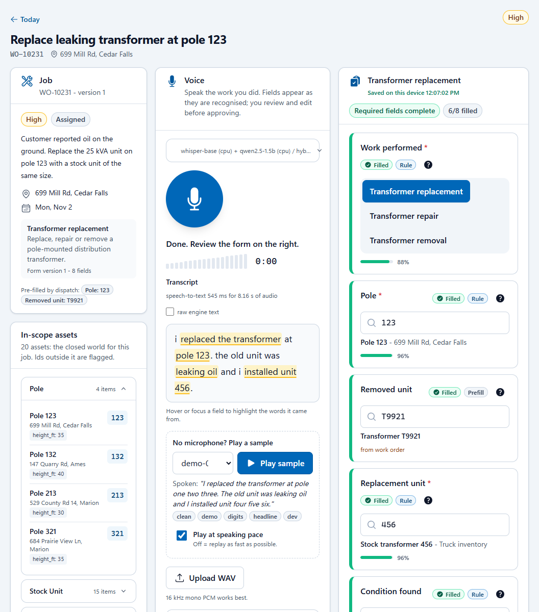
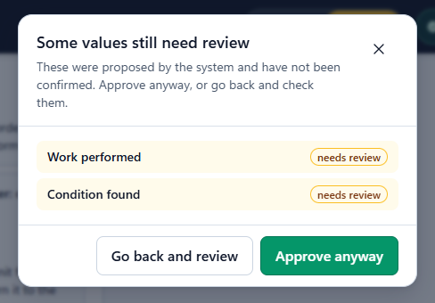
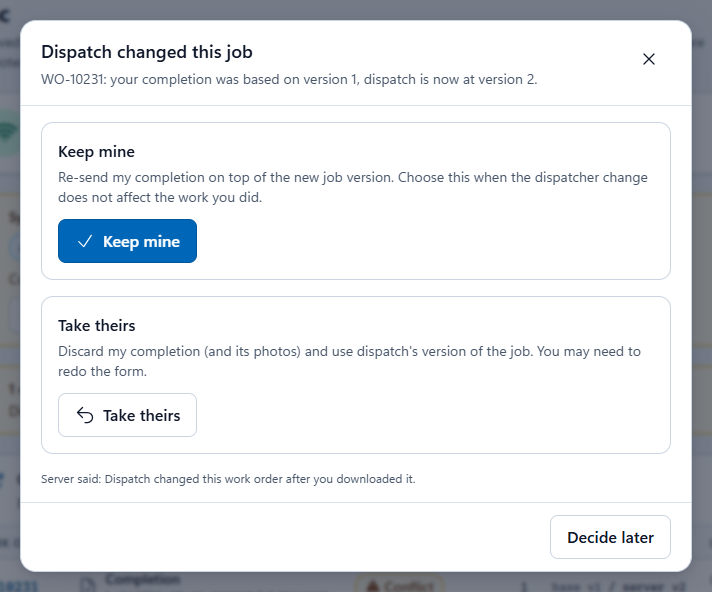
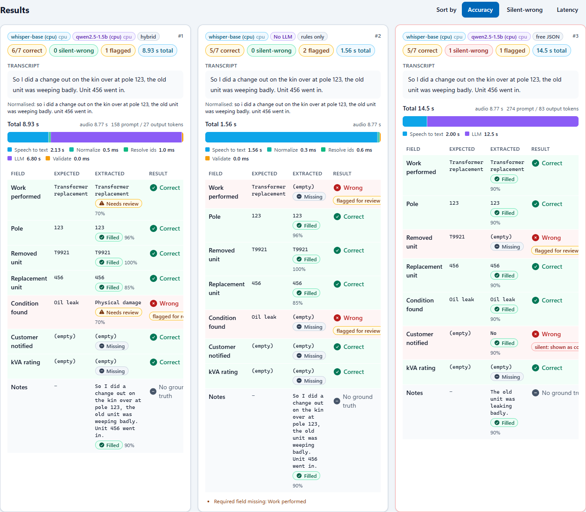
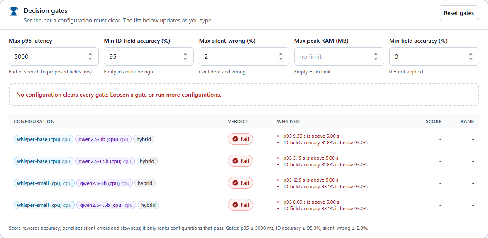

# FieldVoice: offline voice-to-form on Microsoft Foundry Local

A working proof of concept for utility field technicians: **talk, review, save with no signal, then sync.** The speech and
language models run on the device through **Foundry Local** (in-process SDK, **no containers**), and they are swappable and
evaluated on identical input, so the choice of engine is made on evidence rather than opinion.

> *"I replaced the transformer at pole 123. The old unit was leaking oil and I installed unit 456."*
> becomes **Work performed:** Transformer replacement · **Pole:** 123 · **Condition found:** Oil leak ·
> **Replacement unit:** 456. The worker reviews and edits it, it is saved on the device, and it syncs when the device is back
> online.

> **All data in this repository is synthetic.** The workers, work orders, assets, forms, procedures and recordings are invented
> (the speech is generated with Windows text-to-speech). Any resemblance to a real person, address, asset or customer is
> coincidental. Read [Honest status](#honest-status) before quoting any number.

<p align="center">
  
</p>

*The job page after the sentence above: transcript with the evidence for each field highlighted, and the form filling in on the
right with a source and a confidence for every value. More screenshots below; the full guided tour is in
[docs/WALKTHROUGH.md](docs/WALKTHROUGH.md).*

## What it demonstrates

| Phase | In the app |
|---|---|
| **Morning, connected** | Sign in (demo PIN `1234`) → **Morning**: download the day's work package (work orders, forms, assets, procedures), compile reference data, make sure the models are on the device, run an offline-readiness self-test. |
| **Day, disconnected** | Flip the **airplane-mode switch**. Open a work order → talk (or play a sample, or type) → local speech-to-text → deterministic field extraction, plus a small local language model only for what the rules cannot read → review and edit, with the evidence and confidence for every value → approve. Search procedures offline. |
| **Back online** | **Sync** the outbox: idempotent and conflict-aware. A **dispatcher console** plays the remote side: change a job meanwhile, or inject failures. |
| **Choosing the engines** | **Models** (what runs on this machine), **Lab** (the same utterance through several speech × language-model × strategy combinations, side by side), **Results** (full evaluation matrix, editable decision gates, Pareto chart, exports). |

<table>
  <tr>
    <td width="50%"><br><sub><b>Nothing approved by accident.</b> Model suggestions are never "filled", only "needs review", and approving with any unconfirmed opens this dialog.</sub></td>
    <td width="50%"><br><sub><b>Nothing silently overwritten.</b> If dispatch changed the job while the worker was offline, sync stops and a person chooses.</sub></td>
  </tr>
</table>

<p align="center">
  
</p>

*The **Lab**: one slang sentence through three approaches. Free JSON (one prompt, the whole form: a reconstruction of the
prototype-style approach) writes a value nobody said, confidently. The hybrid flags its one mistake. Rules only is fastest
and leaves what it cannot read empty.*

<p align="center">
  
</p>

*The **decision gates**: set the bar a configuration must clear (latency, id accuracy, silent-wrong, memory) and the list
updates as you type. On this synthetic audio and laptop nothing clears every gate, which is exactly why the screen is meant
to be re-run with real recordings on the real tablet.*

## Prerequisites

| Requirement | Version | Used for | Notes |
|---|---|---|---|
| **Windows** | 11 24H2 (build 26100) or later, x64 | Foundry Local, Windows text-to-speech for the synthetic audio, the `.bat` helpers | Foundry Local's Windows ML SDK requires 24H2 ([FINDINGS #10](docs/FINDINGS.md)). Developed on build 26300. Earlier builds and Windows 10 are untested. |
| **Python** | 3.11 or later | Backend | Developed on 3.11.9; 3.12+ untested. The setup script creates `.venv` for you. |
| **Node.js** | 20.19+ or 22.12+ | Building the UI (Vite 7) | Developed on 22.x. Not needed to use only the command-line evaluation. |
| **A Chromium browser** | Microsoft Edge or Chrome | The UI | Tested with Edge. A microphone is optional (see below). |
| **Internet access, once** | n/a | Python and npm packages, Foundry Local components, the models | After the morning download the demo needs no internet. |

No GPU or NPU is needed: every model variant is pinned to CPU. No administrator rights were needed on the development
machine. No accounts, API keys or cloud services are needed for the default demo.

## Required resources

| Resource | Size | Needed for |
|---|---|---|
| Python environment (`.venv`) | about 350 MB | Backend |
| `frontend\node_modules` | about 160 MB | Building the UI |
| **Default models**: `whisper-base` (205 MB) + `qwen2.5-1.5b` (1.8 GB) | **about 2 GB**, downloaded on the first morning run into `data\models` | The demo |
| Every model compared in [docs/RESULTS.md](docs/RESULTS.md) | about 21 GB | Only if you re-run the whole comparison |
| Synthetic datasets, runs, local store | about 40 MB | Datasets are generated on your machine; they are not in the repository |
| **Memory** while running | about 2 GB resident for the default pair; 3-5 GB for a 3-4B language model | Measured on the development laptop. 8 GB machines are untested. |
| Microphone | optional | **Play sample** and **Type a transcript** need none; live capture through the backend is untested ([Honest status](#honest-status)) |
| Azure Speech key and region, or Azure embedded-speech model files | optional | Only for the optional Azure comparison engines. Not used by default and not measured. |

**Models are not in this repository** (they are large and are downloaded from the Foundry Local catalog on first use). The
`.gitignore` keeps `data\` and every model, audio and database file out of version control.

## Quick start

```bat
scripts\setup_backend.bat        :: creates .venv and installs the backend (internet, once)
scripts\build_dataset.bat        :: optional, about a minute: the synthetic evaluation dataset and its speech
scripts\run_demo.bat             :: builds the UI the first time, serves everything on http://127.0.0.1:8010 and opens the browser
scripts\load_sample_results.bat  :: optional: shows the shipped evaluation runs on the Results page
```

1. Open **Morning**, pick **Alex Rivera**, enter PIN **`1234`** (every synthetic worker uses it), press **Sign in**.
2. Press **Start my day**. The first run downloads the two default models (about 2 GB) into `data\models`; later runs take
   seconds. The result is **Offline ready**, or **Ready, warnings** if the self-test's language-model stage was slow on a busy
   machine (still usable).
3. Press **Go offline** (the airplane-mode switch), open the first job on **Today**, choose **demo-01** in *Play sample* and
   watch the form fill.
4. Follow the 12-minute script in [docs/DEMO.md](docs/DEMO.md), or read the narrative version with screenshots in
   [docs/WALKTHROUGH.md](docs/WALKTHROUGH.md).

`run_demo.bat` builds the 11 scripted demo lines by itself the first time (a few seconds); `build_dataset.bat` adds the
larger evaluation dataset.

## Configuration

Nothing is required. To change a default, copy [`.env.example`](.env.example) to `.env` (git-ignored) or set the variable in
the environment. The settings you are most likely to touch:

| Setting | Default | Meaning |
|---|---|---|
| `FV_API_PORT` | `8010` | Port for the API and the built UI. Read from the **process environment** by the launchers, not from `.env`: `set FV_API_PORT=8020` then `scripts\run_demo.bat`. |
| `FV_MANIFEST_STT_ENGINE` | `foundry:stt:whisper-base:cpu` | Speech model the morning package asks the device to hold. |
| `FV_MANIFEST_LLM_ENGINE` | `foundry:llm:qwen2.5-1.5b:cpu` | Language model the package asks for. |
| `FV_DATA_DIR`, `FV_MODEL_CACHE_DIR` | `./data`, `./data/models` | Where datasets, runs, the local store and the models live. |
| `FV_PATCH_PROMPT` | `v4` | How the hybrid pipeline words its question to the language model (`v0` to `v4`; see RESULTS.md section 2.3). |
| `FV_MAX_LOADED_MODELS` | `3` | Models kept in memory at once (least recently used is unloaded). |
| `FV_FOUNDRY_REGISTER_EPS` | `false` | `true` exposes GPU/NPU model variants. They can fail to load on some devices, so CPU-only is the default. |
| `FV_DEVICE_PROFILE` | `dev-box` | Label stamped on every evaluation run, for example `latitude-7220`. |
| `FV_SOR_URL` | empty | Empty uses the built-in mock system of record; a URL points the device at an external service that implements the contract in [docs/SYSTEMS.md](docs/SYSTEMS.md). |
| `FV_AZURE_SPEECH_KEY`, `FV_AZURE_SPEECH_REGION`, `FV_EMBEDDED_SPEECH_MODEL_PATH` | unset | Optional Azure Speech comparison engines. |

## Deployment

**There is very little to deploy.** FieldVoice is a single local process: no container host, no database server, no cloud
resources, nothing to provision. It was built to answer "does this work on the device, and with which models?".

| Mode | Command | What runs |
|---|---|---|
| **Demo** (device-like) | `scripts\run_demo.bat` | One process serves the API and the built UI on `http://127.0.0.1:8010`. This is what the demo and the screenshots use. |
| **Development** | `scripts\run_all.bat` | API on `:8010` and the Vite dev server on `:5173` with hot reload, in two windows. |
| **UI only** | `scripts\run_frontend.bat mock` | The UI against a built-in mock API: no Python, no models. |
| **Command line** | `scripts\run_eval.bat`, `scripts\bench_device.bat` | The evaluation harness and the device probe ([below](#compare-engines-from-the-command-line)). |

* **Network exposure.** The server binds to `127.0.0.1` only, with no TLS and a demo PIN. Do not expose it on a network.
* **State.** Everything the app creates lives under `data\` (git-ignored): `models\`, `datasets\`, `runs\`, `bench\` and
  `demo\` (the SQLite store and the mock dispatch state). The store is **not encrypted** in the demo. The Foundry Local SDK may
  keep other runtime files outside the repository; they have not been inventoried.
* **Installing on another machine.** Clone, run `scripts\setup_backend.bat`, `scripts\run_demo.bat`; the models download on
  the first morning run. For a machine with no internet, copying `data\models` from a prepared machine is expected to work
  but **has not been tested**, and offline package caches for pip and npm are not covered.
* **Clean take.** In the app: Sync → Dispatcher console → *Reset system of record* with *Also wipe this device* ticked (signs
  the worker out and removes the downloaded work, drafts and outbox; models stay). To uninstall, delete the folder.
* **What a real field deployment would add** (not built): a native Windows client on the Foundry Local C# SDK, device
  management and model distribution, an encrypted store and single sign-on, background sync, a real system-of-record
  integration, and an iOS runner. See [docs/SYSTEMS.md](docs/SYSTEMS.md#not-built-and-what-it-would-take) and
  [docs/ARCHITECTURE.md](docs/ARCHITECTURE.md#deployment-shapes).

## Compare engines from the command line

```bat
scripts\bench_device.bat --stt foundry:stt:whisper-base:cpu --llm foundry:llm:qwen2.5-1.5b:cpu   :: 1-minute device probe: run this first on a new device
scripts\bench_device.bat --stt foundry:stt:nemotron-speech-streaming-en-0.6b:cpu --live          :: how long the worker waits after the last word
scripts\run_eval.bat engines                                     :: what is available / needs download
scripts\run_eval.bat run --stt foundry:stt:whisper-base:cpu --stt foundry:stt:whisper-small:cpu --strategy rules_only
scripts\run_eval.bat run --llm foundry:llm:qwen2.5-0.5b:cpu --strategy free_json --strategy hybrid --limit 60
scripts\run_eval.bat rescore <run_id>                            :: re-score a past run's transcripts after changing the rules (no audio, seconds)
scripts\run_eval.bat report <run_id>                             :: decision report with gates + Pareto
```

Metrics, gates, datasets and how to swap in real recordings: [docs/EVALUATION.md](docs/EVALUATION.md). The runs behind the
numbers below ship in [`results/`](results/README.md); load them into the app with `scripts\load_sample_results.bat`.

## Results at a glance

Synthetic data on one developer laptop (Core Ultra 7, 64 GB): **these rank options against each other, they do not predict
field accuracy or tablet latency.** Details and method: [docs/RESULTS.md](docs/RESULTS.md).

| Question | Answer from the runs so far |
|---|---|
| Whisper sizes | tiny / base / small / medium: id-field accuracy 84 / 90 / 94 / 94 %, real-time factor 0.09 / 0.14 / 0.45 / 1.16. **Base** is the default; medium buys nothing over small; none clears a 95 % id gate on noisy synthetic audio. |
| Streaming (Nemotron) | Final text **0.19 s** after the last word here (batch Whisper: 1.2-9.5 s) at Whisper-base accuracy, but it drops spoken corrections ("sorry, 328") and only hides latency while its real-time factor stays below 1 (0.45 here, unmeasured on the tablet). |
| Does the language model help? | Rules plus the job's closed world give 100 % id accuracy and 82 % field accuracy on held-out slang with no model. A 1.5B model lifts field accuracy to 93 %, a 3B-class model to 98 % (enum fields 38 % → 77 % → 94 %). A 0.5B model's suggestions are wrong more often than right: do not ship it. |
| Qwen vs Phi vs Ministral | Qwen2.5-3B, Ministral-3-3B and Phi-4-mini tie at 94 % enum accuracy (Phi-3.5-mini 90 %). Qwen2.5-3B is the cheapest (3 GB, about 6 s a call here); the other two add zero hallucination for about 1.5x the memory. |
| Is the model safe? | **Silent-wrong** (confident and wrong) is **0 %** for every model: its answers are always "needs review". About a fifth of fields arrive as suggestions to confirm. |
| What if the model does everything? | Prototype-style free JSON was silently wrong on 18 % of its confident fields; a tight-grammar LLM-only strategy on about half. The deterministic layer is what removes them. |
| Why was the prototype slow? | A model call costs its **prompt**: about 18 ms per prompt token for a 1.5B model here, roughly 90 % of a call. The design calls the model only for what the rules could not explain, with a short prompt and a tight grammar. |
| Azure Speech | Implemented, **not measured** (needs credentials). Its phrase lists are the likeliest route past the 95 % id gate. |
| The rugged tablet | **Not measured.** Run `scripts\bench_device.bat` on it first. |

## Repository map

```
backend/        Python 3.11: schemas · core (normalize, resolve, validate, six strategies) · engines (Foundry Local, Azure, oracle)
                · evalkit (runner, metrics, report, CLI, device probe) · synth (world, utterances, text-to-speech, noise)
                · demo (local store, auth, bundle, knowledge base, sync, mock system of record) · api (FastAPI) · tests
frontend/       React 18 + TypeScript + Vite + Tailwind + TanStack Query (also runs against a built-in mock API)
docs/           WALKTHROUGH · DEMO · RESULTS · ARCHITECTURE · EVALUATION · DATASET · SYSTEMS · UI · IOS_SPIKE · FINDINGS · CONTRACT, and images/
results/        Stored evaluation runs and device benchmarks behind RESULTS.md (synthetic; about 8 MB)
ios-spike/      iOS feasibility kit: golden vectors and a Swift benchmark harness (not compiled)
scripts/        .bat helpers: setup, run, dataset, evaluation, benchmark, tests
data/           created at runtime and git-ignored: models, datasets, runs, the local store
```

## Tests

```bat
scripts\run_tests.bat              :: backend pytest (no network, no model download) + frontend typecheck, unit tests and build
.venv\Scripts\python.exe -m pytest backend/tests
```

## Troubleshooting

| Symptom | What to do |
|---|---|
| `run_demo.bat` fails with "address already in use", or the browser shows another program's page | Another program holds 8010. `set FV_API_PORT=8020` and run it again (Docker and WSL often hold 8000, which is why 8010 is the default). |
| `npm install` cannot reach a registry | The lockfile carries no registry URLs, so npm uses your configured registry. Behind a corporate mirror, `npm config set registry <your mirror>`. |
| The morning run stops at "Make sure the AI models are on the device" | The first run needs internet to download the models (about 2 GB). Check the proxy or firewall, then press *Run it again*. `scripts\run_eval.bat engines` lists what is available. |
| The readiness chip is amber ("Ready, warnings") | The self-test's language-model stage must answer within 5 s and the machine was busy or slow. It is still usable; the warning says why. |
| `build_dataset.bat` logs "no audio generated" | Speech synthesis needs Windows PowerShell and an installed English voice (`System.Speech`). Without one the dataset is built without audio: the Lab and typed transcripts still work, but evaluating speech engines needs the audio. |
| Frontend commands fail with a Node error | Vite 7 needs Node 20.19+ or 22.12+. |

## Honest status

**Verified on the development laptop** (Core Ultra 7, 64 GB, Windows 11 — *not* representative of the target tablets): the
whole day runs end to end in a browser against the real backend and real Foundry Local models: sign-in, morning prep (package,
model load, readiness self-test), offline voice from sample playback through real Whisper, rules and model extraction with
evidence and confidence, approval, and sync with a version conflict, a lost reply and an idempotent retry. The offline and sync
logic is also covered by automated tests, and the extraction logic is regression-tested against a generated corpus that found
and fixed ten real defects ([docs/DATASET.md](docs/DATASET.md#what-the-data-found)).

**Not verified, or not built:**

* **Speed and memory on the rugged tablet** (8th-generation CPU, no NPU). Nothing measured here predicts it; the sizing in
  RESULTS.md section 5 is an estimate. Run `scripts\bench_device.bat` on the device first.
* **Real field speech.** The audio is clean synthetic speech plus simulated noise; accents, wind and radio chatter will be
  worse.
* **The operating system's network actually disabled.** "Offline" is the app's airplane-mode switch; the AI parts make no
  network calls, but a test with the adapter disabled has not been run.
* **Microphone capture against the real backend**, and any browser other than Edge/Chromium. Sample playback and the
  WebSocket path with fake engines are tested.
* **Azure Speech engines** (embedded and cloud): implemented, never run (they need credentials or limited-access files).
* **iOS.** Foundry Local does not target iOS. `ios-spike/` is uncompiled scaffolding plus tested Python tooling.
* **Security hardening** (encrypted store, single sign-on instead of the demo PIN, device management) and a real
  system-of-record integration.
* **Windows 10, Python 3.12+ and 8 GB machines** are untested.
* Foundry Local's own network behavior and telemetry have not been audited. This app makes no cloud calls at inference time.

## Models and licenses

The models are **not** part of this repository. They are downloaded from the Foundry Local catalog on first use; check each
model's license and terms yourself before any production use. As reported by the catalog on the development machine:

| Model family | Used here | Catalog-reported license |
|---|---|---|
| Whisper (tiny, base, small, medium) | Speech-to-text | Apache-2.0 |
| Nemotron speech streaming 0.6B | Streaming speech-to-text | MIT |
| Qwen2.5 (0.5B, 1.5B, 3B) | Field extraction | Apache-2.0 |
| Ministral-3-3B | Field extraction | Apache-2.0 |
| Phi-3.5-mini, Phi-4-mini | Field extraction | MIT |

## Documentation

| Document | What it is |
|---|---|
| [docs/WALKTHROUGH.md](docs/WALKTHROUGH.md) | **Start here.** The demo told step by step with screenshots, business context and the technical detail behind each step. |
| [docs/DEMO.md](docs/DEMO.md) | The presenter's 12-minute script and talking points |
| [docs/RESULTS.md](docs/RESULTS.md) | What the evaluation measured, how to read it, and what would change the conclusions |
| [docs/ARCHITECTURE.md](docs/ARCHITECTURE.md) | Components, the extraction pipeline, engines, deployment shapes, extension points |
| [docs/EVALUATION.md](docs/EVALUATION.md) | Metrics, decision gates, strategies and how to replace synthetic data with real recordings |
| [docs/DATASET.md](docs/DATASET.md) | The synthetic world and datasets, and the bugs the data found |
| [docs/SYSTEMS.md](docs/SYSTEMS.md) | Local store, sign-in, work package, knowledge base, sync, dispatcher console, and what is not built |
| [docs/UI.md](docs/UI.md) | The frontend: pages, mock mode, Field mode, smoke test |
| [docs/CONTRACT.md](docs/CONTRACT.md) | REST and WebSocket contracts and conventions |
| [docs/FINDINGS.md](docs/FINDINGS.md) | Verified research findings about Foundry Local and the engines |
| [docs/IOS_SPIKE.md](docs/IOS_SPIKE.md) | The iOS question: what is known, what the spike kit measures |
| [results/README.md](results/README.md) | Index of the stored evaluation runs |

## About this repository

A proof of concept shared for evaluation, provided as-is with no warranty and no support commitment. No open-source has been applied to it.
