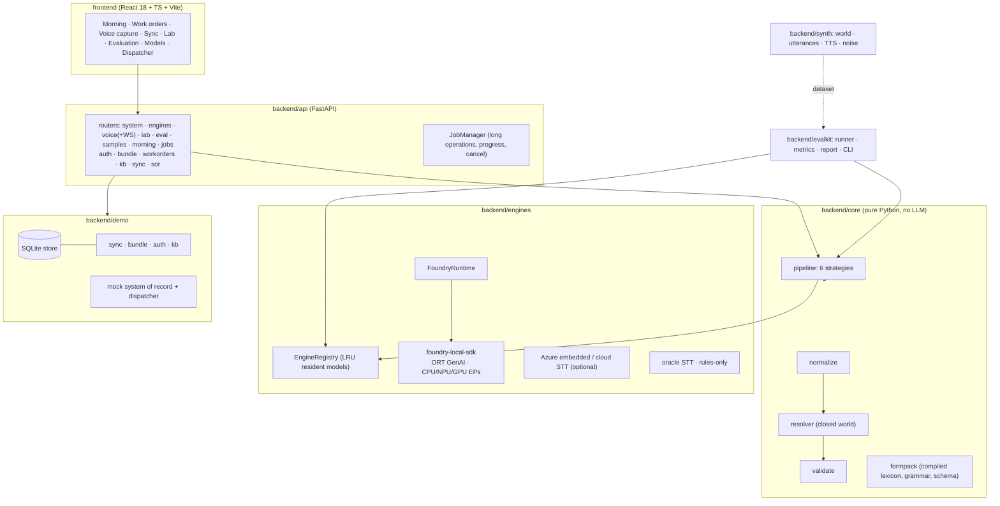
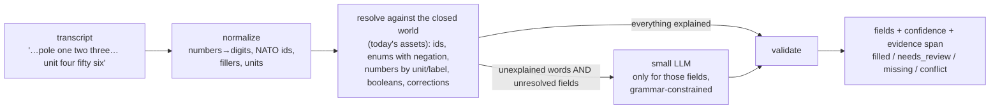

# Architecture

An offline-first **voice-to-form** application for field technicians, built on **Microsoft Foundry Local** (in-process SDK,
no containers). The AI part is deliberately small and measurable; most of the engineering is what makes it work with no
signal and what keeps it from silently writing wrong values into a system of record.

## Constraints that shaped it

| Constraint | Consequence |
|---|---|
| No containers on the device | Foundry Local runs **in-process** (Python SDK here; the same runtime has C#/JS/Rust SDKs). No Docker, no external model server. |
| Rugged Windows tablets today (8th-gen CPU, no NPU, 8-16 GB), ~80 % iOS later (as described to us) | Everything is **CPU-first and small-model-first**; accelerators are opt-in. iOS is a separate runtime question (see [IOS_SPIKE.md](IOS_SPIKE.md)); the contracts and the deterministic core port. |
| The current prototype takes ~45 s per extraction (as reported) | The design goal is **seconds**, by not asking the LLM what rules can answer (hybrid), not by buying a bigger device. |
| Disconnected for hours | The morning bundle is self-contained (work orders, forms, assets, KB, models). Approval is local and atomic; sync is idempotent. |
| A wrong id on a work order is worse than an empty field | Closed-world validation, confidence + review states, and a **silent-wrong** metric instead of plain accuracy. |
| Choice of engine/model unsettled (Whisper vs Azure Speech; Phi vs Qwen vs Ministral) | Engines and strategies are **pluggable and evaluated on identical input**; nothing is hard-wired. |

## Components

Dependencies point one way: `schemas` ← `core` ← `engines`/`evalkit` ← `api`. `demo` (store/sync) and `synth` depend only on
`schemas` and a few helpers, so each can be replaced independently.

## The extraction pipeline (the accuracy-critical part)

* **Normalize** (`core/normalize.py`): "pole one two three", "pole 1 2 3", "pole 1-2-3" (Whisper-medium) and "pole 123" become
  the same thing; NATO spellings become ids (`T4471`); lone "one" after "the old …" stays a word. Microseconds.
* **Resolve** (`core/resolver.py`): assigns ids to roles using role words ("pole", "old unit", "installed") *and* what kind
  of asset the id is in today's world; handles spoken corrections ("123, sorry, 132"), negation ("not leaking" → none),
  units ("25 k v a"), and refuses to guess: an id not in the job's assets is `needs_review` with the closest valid ids offered.
* **LLM gate** (`core/pipeline.py`): the model is called only when words remain that nothing explained **and** fields are
  still unresolved - and only for those fields, with a tight Lark grammar (enums, candidate-restricted ids, `null`).
  Suggestions are `needs_review` (never "filled"): a small model is a helper, not an authority. Three guards keep a weak
  model from putting words in the worker's mouth, each found by running the pipeline over generated data:
  * *what counts as "explained"*: a word is excused only if a phrase matched it, or it is structural (labels, role and unit
    words, generic work talk). Words that merely occur in the **wording of some option** ("fine", "good") do not excuse
    themselves - otherwise "it checks out fine" never reaches the model (`FormPack.structural_stems`);
  * *topic*: a boolean is only asked about when the statement touches its topic (`FormPack.topic_stems`) - a boolean nobody
    talked about is "not stated", never `false`;
  * *absence*: the model may claim "none / no issues" only when the statement says something negative or reassuring
    (`FormPack.absence_supported`) - "not stated" is not "no issues".
* **Validate** (`core/validate.py`): required fields, conditional requirements, ranges.

Strategies (ablation ladder, selectable per request): `free_json` (today's baseline), `schema_constrained`, `enum_grammar`,
`hybrid`, `hybrid_always`, `rules_only`. See [EVALUATION.md](EVALUATION.md).

## Engines and models

`EngineRegistry` discovers STT and LLM engines (Foundry catalog + optional Azure + oracle/rules), reports availability
(`ready` / `needs_download` / `unavailable` / `error`), loads on demand and keeps at most `FV_MAX_LOADED_MODELS` resident
(LRU). Foundry variants are **pinned to CPU** unless opted in: with Windows ML execution providers registered the SDK's
automatic selection picked an OpenVINO NPU variant that failed to load on the dev box ([FINDINGS.md](FINDINGS.md)).

Speech: file transcription for Whisper-class models; **live streaming** (interim text <1 s) for Nemotron streaming via
`AudioSession`; Azure embedded/cloud engines are implemented but untested without credentials/model files.

## Offline systems

Bundle download + integrity check, SQLite store with atomic approval and outbox, PIN offline unlock, offline KB search, and
an idempotent, conflict-aware sync - see [SYSTEMS.md](SYSTEMS.md).

## Observability

Every extraction returns per-stage timings (`stt`, `normalize`, `resolve`, `llm`, `validate`), token counts and warnings;
the WebSocket streams `partial` → `transcript` → `stage`/`fields` events so the UI fills progressively and shows the latency
waterfall. The evaluation harness aggregates the same numbers (p50/p95, RTF, cold start, RAM delta).

## Deployment shapes

| Shape | Status |
|---|---|
| **Single process on the tablet**: `uvicorn` serves the API and the built UI; the browser/WebView connects to `127.0.0.1`. `scripts\run_demo.bat`. | Implemented - what the demo uses. |
| Native Windows app (WinUI/WPF/MAUI) using the Foundry Local C# SDK and the same contracts | Recommended production direction for Windows; the Python core is the reference implementation to port. |
| iOS app: native SwiftUI + ported deterministic core + on-device model runner | Needs the spike in [IOS_SPIKE.md](IOS_SPIKE.md). Foundry Local itself does not target iOS. |

## Extending

* **New form**: add a `FormSchema` (lexicon, triggers, entity kinds). `lint_form()` flags ambiguous synonyms. No code change.
* **New STT/LLM engine**: implement `SttEngine`/`LlmEngine` (`engines/base.py`), register it; it appears in the UI and the CLI.
* **New strategy**: add a function in `core/pipeline.py` and a `StrategyInfo` in `core/strategies.py`.
* **New metric/gate**: `evalkit/metrics.py`, `evalkit/report.py`.

## Security notes (demo grade)

Local store unencrypted; demo PIN auth; no TLS between the browser and `127.0.0.1`; secrets only via `.env` (`FV_*`). Anything
touching a production system of record is out of scope. See "Not built" in
[SYSTEMS.md](SYSTEMS.md#not-built-and-what-it-would-take).
