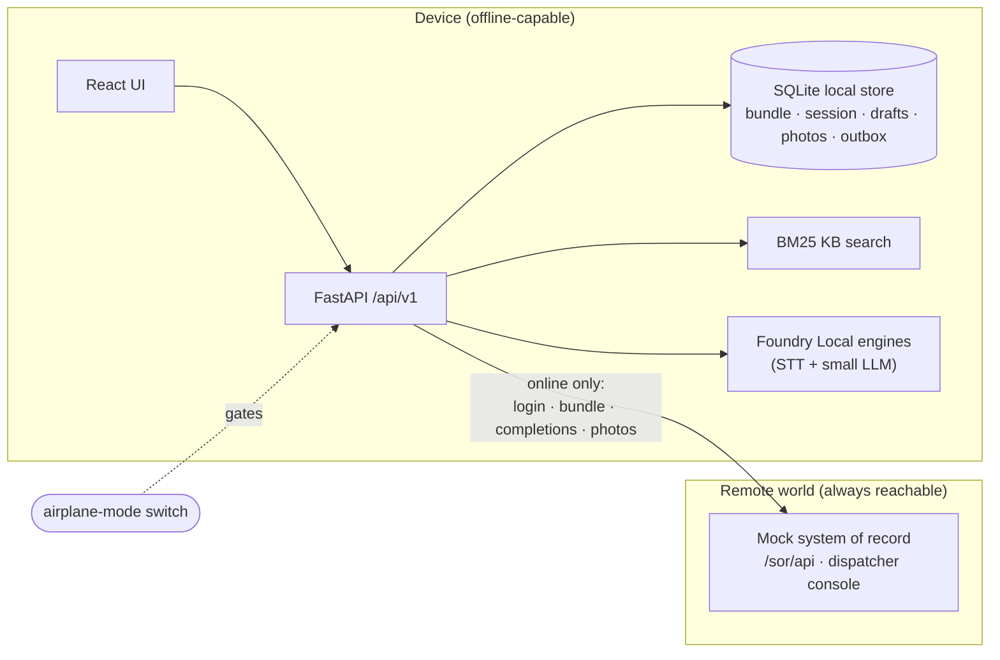

# Offline systems: local store, auth, bundle, knowledge base, sync, mock system of record

This is the part of the demo that is **not AI** - and the part that decides whether a technician can actually work a day
with no signal. Everything below is implemented and covered by `backend/tests/demo` (no network, no models).

## Day in the life

| Phase | What happens | Code |
|---|---|---|
| Morning, connected | Worker signs in with a PIN (online login stores an *offline grant*). `POST /morning/start` runs: verify session → download the **bundle** (work orders, forms, assets, KB, model manifest) and verify its hash → compile form packs + index the KB → make sure the manifest's models are on the device (download if needed) → readiness self-test. | `auth.py`, `bundle.py`, `api/routers/morning.py`, `demo/readiness.py` |
| Day, disconnected | Everything is served from the local store. The app can be locked/unlocked with the PIN. Voice → fields → review → **approve**, which atomically writes the approval and the outbox rows. | `store.py`, `api/routers/workorders.py` |
| Back online | `POST /sync/run` sends the outbox. Idempotent, conflict-aware (below). | `sync.py` |

The **connectivity switch** (`POST /system/connectivity`) is the demo's airplane mode. Calls to the remote check it first
(HTTP 503 `{"detail":{"code":"offline"}}`); the dispatcher console and the in-process mock system of record are *the
remote world* and stay reachable.

## Local store (`backend/demo/store.py`)

SQLite in WAL mode behind one locked connection: `kv` (bundle, session, offline grants), `drafts`, `photos`, `outbox`.
`approve_draft()` runs in one transaction: it marks the draft approved, assigns the **operation id** (the idempotency
key) and inserts the outbox rows (one completion + one per photo). Approving twice returns the same operation, never a
second. Photos uploaded before the client's next autosave are merged into the draft so a stale client cannot drop them.

> The database file is **not encrypted** and the session token sits in it. A production build needs an encrypted store
> (SQLCipher or platform data protection), secrets in the OS keystore (DPAPI / Keychain), and device management.

## Authentication (`backend/demo/auth.py`)

* Online: the system of record validates worker + PIN and returns a token; the device stores the session and an **offline
  grant** = salted PBKDF2-HMAC-SHA256 verifier of the PIN (never the PIN), valid for 48 h.
* Offline: only a worker with a valid grant can unlock, with the right PIN (`mode: "offline_unlock"`); wrong PIN → 401, no
  grant or expired grant → 503 `offline`. If the device *thinks* it is online but the server answers 503, login falls
  back to the offline unlock.
* Demo PIN for every synthetic worker is `1234`. Real deployments should use Entra ID / platform SSO with conditional
  access instead of a shared PIN scheme - this is a stand-in that demonstrates the *offline unlock* behaviour.

## Bundle (`backend/demo/bundle.py`)

The system of record assembles, per worker: their work orders, the forms they use, the assets they reference **plus the
truck's stock inventory**, the KB documents attached to those jobs and a **model manifest** (`stt` required, `llm`
optional - rules-only is the fallback). The device recomputes the content hash and refuses a package that does not match;
nothing is stored on failure. The bundle expires 36 h after issue (the readiness check fails after that).

`job_assets(work_order_id)` = the job's assets + inventory = the **closed world** the extraction resolves ids against.

Fields the dispatcher pre-filled (`WorkOrder.prefill`, e.g. the pole and the transformer being removed) arrive on the form
with source `prefill` and are not part of what the worker has to say; speech that contradicts them replaces them. The
engine lists (`GET /engines`) tag the engines named by the manifest `in-work-package` and put them first, so "the first
ready engine" is the one morning prep prepared.

## Knowledge base (`backend/demo/kb.py`)

BM25 over document sections (title and heading words count double), stemmed with the same stemmer as the normalizer,
boosted for documents attached to the open work order and those that apply to its form or asset kinds. Pure Python; works
with no network and no model. The bundled documents are synthetic placeholders.

## Sync (`backend/demo/sync.py`)

* **Nothing lost** - the outbox is written in the approval transaction and survives restarts.
* **Nothing applied twice** - every completion carries its operation id; the server answers a repeat with the original
  result (`status: "duplicate"`). A lost response (HTTP 504 after the server committed) is therefore safe to retry.
* **Nothing silently overwritten** - the completion carries `base_version`. If dispatch changed the job meanwhile, the
  server returns 409 with its version; the item becomes `CONFLICT` and the draft `conflict`. The worker chooses:
  *keep mine* (rebase to the server's version and re-send the same operation) or *take theirs* (discard the local result
  and refresh the work order).
* Transient failures (503/504/network) mark the item `FAILED` and are retried on the next run with `attempts` counted.
* An expired session during sync → 401 `session_expired` (sign in again while connected).

## Mock system of record (`backend/demo/sor/`)

`SorService` holds dispatch state (work orders with versions), issues bundles, accepts completions and photos, and
persists to `data/demo/sor.json`. It is called in-process by default; `backend.demo.sor.app` exposes the same operations at
`/sor/api/{login,bundle,completions,photos}` so the device can also be pointed at an external service (`FV_SOR_URL`).

The **dispatcher console** (`/api/v1/sor/*`) is for demos and tests: bump a work order's version (simulating a dispatcher
edit), and inject faults - `fail_next` (503 before any work), `latency_ms`, `drop_response_next` (commit, then 504) and
`conflict_next` (reject as if dispatch changed the job). `POST /sor/reset?device=true` resets both worlds for a clean run
(the device's local store and its last readiness report are wiped and the connectivity switch returns to Online, so the
next sign-in starts from nothing).

## Endpoints

See [CONTRACT.md](CONTRACT.md) section 6. Errors: offline → 503 `offline`; no session → 401 `unauthenticated`; no bundle →
409 `no_bundle`; approved forms are locked (409 `draft_locked`); approving with required fields empty → 422
`missing_required_fields` with the field keys.

## Not built (and what it would take)

* Encrypted storage, key management, remote wipe, MDM enrollment.
* Real system-of-record integration (the mock defines the *shape* of the contract: bundle, idempotent completions,
  optimistic concurrency, photo upload).
* Background/scheduled sync and resumable large uploads; photo compression.
* Multi-user devices, conflict resolution at field level (today: whole-form keep-mine / take-theirs).
* iOS: a separate client; see [IOS_SPIKE.md](IOS_SPIKE.md).
