# FieldVoice walkthrough: from the morning download to the evening sync

A guided tour of the proof of concept: what a technician sees, what the software does underneath, and why each design
choice was made. It has two kinds of reader in mind: **field-operations and business leads** (sections 1-5 and 8-9 are in
plain language) and **engineers and architects** (sections 6-7 go into the pipeline, the contracts and the measurements).
The presenter's cheat sheet for a live session is [DEMO.md](DEMO.md); setup and prerequisites are in the
[README](../README.md).

> **Everything here is synthetic.** The workers, work orders, assets, forms, procedures and recordings are invented (the
> recordings are generated with Windows text-to-speech). Place names are ordinary US towns; street addresses are made up,
> and any resemblance to a real address, asset or customer is coincidental. The procedures in the knowledge base say "not
> an operating procedure" and must not be used as one.
>
> The screenshots come from the running app on a developer laptop (Intel Core Ultra 7, 64 GB, Windows 11) that was also
> busy with other work, so **the timings in the pictures are illustrative**. The controlled measurements are in
> [RESULTS.md](RESULTS.md). None of them was taken on the field tablets.

**Contents**

1. [The problem and what we set out to prove](#1-the-problem-and-what-we-set-out-to-prove)
2. [The day in one picture](#2-the-day-in-one-picture)
3. [The cast: synthetic people, jobs and assets](#3-the-cast-synthetic-people-jobs-and-assets)
4. [Step by step](#4-step-by-step) (morning, day, back online)
5. [Choosing the engines on evidence](#5-choosing-the-engines-on-evidence)
6. [How it works](#6-how-it-works-technical)
7. [What we measured](#7-what-we-measured)
8. [What it means for the fleet, and what to do next](#8-what-it-means-for-the-fleet-and-what-to-do-next)
9. [What is proven and what is not](#9-what-is-proven-and-what-is-not)
10. Appendices: [scripted demo lines](#appendix-a-the-scripted-demo-lines) · [FAQ](#appendix-b-faq) · [glossary](#appendix-c-glossary)

---

## 1. The problem and what we set out to prove

A technician finishes a job and has to turn what they did into a structured record: which work was performed, on which
asset, what was found, which unit went in. Typing that on a tablet, in gloves, often with no signal, is slow. Speaking it is
fast, but speech is only useful if it becomes **structured, validated** data: a wrong pole or transformer number in the
system of record is worse than an empty field.

The scenario from our conversation is one sentence:

> "I replaced the transformer at pole 123. The old unit was leaking oil and I installed unit 456."

| What was said | Becomes (field) | Value |
|---|---|---|
| "replaced the transformer" | Work performed | Transformer replacement |
| "pole 123" | Pole (the asset) | Pole 123 |
| "leaking oil" | Condition found | Oil leak |
| "installed unit 456" | Replacement unit (the replacement asset) | 456 |
| (not said; dispatch already knew) | Removed unit | T9921 |

The worker reviews and edits it, the form is saved on the device, and it is synchronized to the system of record when the
device is back online.

### What the proof of concept has to show

| Goal | Where you see it |
|---|---|
| **Voice in, structured form out**: fields filled from speech, not typed | Steps 5-6 |
| **No signal needed**: after the morning download everything runs on the device | Steps 3-8 |
| **Small local models, chosen on evidence**: Whisper vs other speech engines; Qwen vs Phi vs Ministral for extraction | Section 5 |
| **The worker stays in control**: every value shows where it came from; unsure values are flagged, never presented as settled | Steps 5-7 |
| **Nothing lost, duplicated or silently overwritten** when the device reconnects | Steps 9-10 |
| **Fast enough on modest hardware**: the design avoids asking a language model what rules can answer | Steps 5-6, section 7 |

### Constraints we designed around (as described to us)

| Constraint | Consequence in the design |
|---|---|
| No containers on the device | Foundry Local runs **in-process** through its SDK. No Docker, no model server. |
| Rugged Windows tablets today (an 8th-generation Intel CPU, no NPU, 8-16 GB) and mostly iOS later | Everything is CPU-first and small-model-first. iOS is a separate runtime question ([IOS_SPIKE.md](IOS_SPIKE.md)). |
| The current prototype takes about 45 s per extraction (as reported) | The design target is seconds, by not asking a language model what rules can answer. |
| Disconnected for hours | The morning package is self-contained; approval is local and atomic; sync is idempotent. |
| The speech and language models are not yet chosen | Engines and strategies are pluggable and are evaluated on identical input. |

### What to baseline with the customer

The demo ships with starting gates (p95 end-of-speech-to-fields at most 5 s, id-field accuracy at least 95 %, silent-wrong at
most 2 %), and every one is editable on the Results page. They are **placeholders to agree on**, not requirements we were
given. The measures worth fixing before a pilot:

| Measure | Why it matters | Where it is measured today |
|---|---|---|
| Time from end of speech to a filled form (p50 / p95) | What the worker waits for | Evaluation runs and `scripts\bench_device.bat`; **not yet on a tablet** |
| Id-field accuracy (poles, units, meters) | A wrong id is the costly error | Evaluation runs, synthetic data |
| **Silent-wrong rate**: confident fields that are wrong | The error nobody notices | Evaluation runs, synthetic data |
| Share of fields the worker has to correct | Whether voice actually saves time | **Needs a field trial** (not instrumented in the demo) |
| Memory and start-up time on the device | Whether it fits an 8 GB tablet next to the work apps | Device probe on the dev laptop; **not yet on a tablet** |
| Completions lost, duplicated or overwritten in sync | Trust in the record | Automated tests and the dispatcher console |

---

## 2. The day in one picture

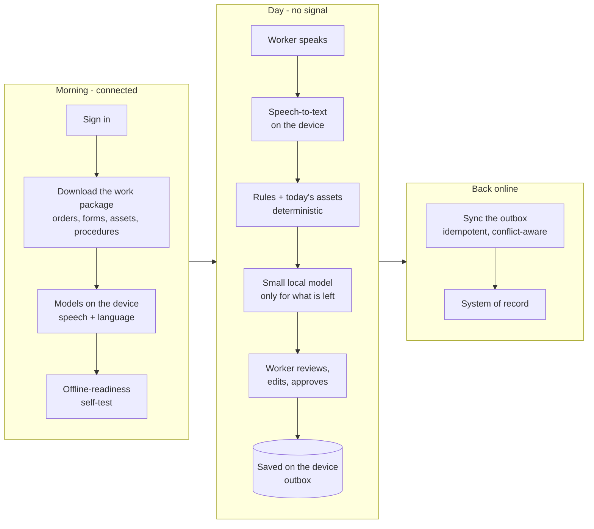

| Phase | What happens | Network needed? |
|---|---|---|
| **Morning** | Authenticate, download the day's work orders, forms, procedures and reference data, make sure the models are present, prove the device is ready | Yes |
| **Day** | Voice capture, extraction, review, approval, procedure search, all from local data | **No** |
| **Back online** | Send completions and photos; resolve conflicts; see the result | Yes |

---

## 3. The cast: synthetic people, jobs and assets

Everything comes from one deterministic generator (`backend/synth/world.py`), so every run shows the same world.

| Worker | Role | Crew | Sign-in |
|---|---|---|---|
| **Alex Rivera** (`w-1001`), the demo worker | Line technician | 14 | PIN `1234` |
| Jordan Kim (`w-1002`) | Meter technician | 22 | PIN `1234` |
| Sam Patel (`w-1003`) | Troubleshooter | 7 | PIN `1234` |
| Casey Morgan (`w-1004`) | Lineman | 14 | PIN `1234` |

The shared PIN is a stand-in that demonstrates the *offline unlock*; a real deployment would use the customer's identity
provider (for example Microsoft Entra ID or platform single sign-on).

Alex's day has three jobs:

| Work order | Job | Form |
|---|---|---|
| **WO-10231** (high priority) | Replace leaking transformer at pole 123 (the headline job) | Transformer replacement |
| WO-10232 | Replace transformer at pole 374 | Transformer replacement |
| WO-10235 | Ground-line inspection, pole E9 | Pole inspection |

The whole world has 4 workers, 12 work orders, 4 forms (transformer replacement, pole inspection, meter exchange, outage
restoration), 104 assets (42 poles, 15 transformers, 15 stock units, 24 meters, 8 feeders) and 8 short procedure documents.
Alex's morning package holds the 3 jobs above, 2 forms, **27 assets** (the jobs' own assets plus the truck's stock
inventory) and 6 documents.

---

## 4. Step by step

To follow along on your own machine: `scripts\run_demo.bat`, then open http://127.0.0.1:8010 (details in the
[README](../README.md#quick-start)). The numbered steps match the sections of [DEMO.md](DEMO.md). Each step says what you
see, what happens underneath and why it matters.

### Morning, connected

#### Step 1. Sign in

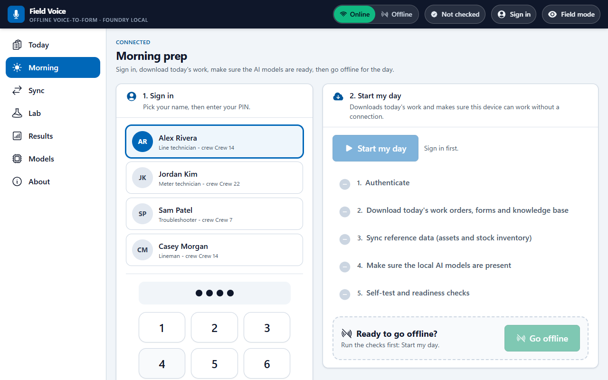
*The Morning page: pick a worker and enter the PIN. Everything on the right waits for a sign-in.*

* **Under the hood.** The device asks the system of record (a mock here) to validate the PIN and stores a session plus an
  **offline grant**: a salted PBKDF2-HMAC-SHA256 verifier of the PIN (never the PIN itself) that is valid for 48 hours. That
  grant is what lets the same PIN unlock the device later with no signal. In the demo a session lasts 12 hours; the
  system of record decides those lifetimes.
* **Why it matters.** "Authenticate the worker" is the first step of the morning flow, and the offline unlock is what makes
  the rest of the day possible.

#### Step 2. Start my day

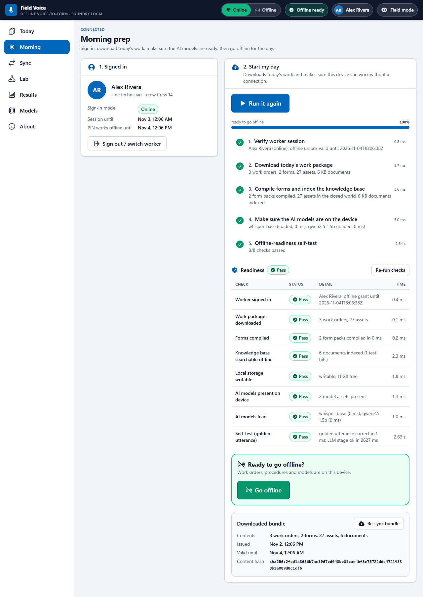

*Five live steps, then a readiness report. Here all eight checks passed ("Offline ready").*

1. **Verify the worker session** and the offline grant.
2. **Download today's work package**: 3 work orders, 2 forms, 27 assets, 6 documents. The device recomputes the package's
   SHA-256 hash and refuses to store it if it does not match.
3. **Compile the forms** into extraction-ready form packs (lexicon, grammar, schema) and **index the procedures** for offline
   search.
4. **Make sure the AI models are on the device**: the work package names the speech and language models the day needs
   (default `whisper-base` and `qwen2.5-1.5b`). Missing models are downloaded now; this is the only time the network is used
   for AI.
5. **Offline-readiness self-test**: eight checks, ending with a "golden" utterance that goes through the real pipeline. The
   self-test's language-model stage has a 5 s budget.

* **Why it matters.** The check **fails closed**: a missing model, an expired package or an unwritable disk is found at the
  depot, not in a substation.
* **Honest notes.** On this laptop the models were already on disk, so steps 4 and 5 took milliseconds and 2.6 s. The very
  first run downloads about 2 GB. When the laptop is busy, the self-test's language-model stage can exceed its 5 s budget
  and the result turns amber ("Ready, warnings"): still usable, and the warning says why.

### Day, disconnected

#### Step 3. Go offline

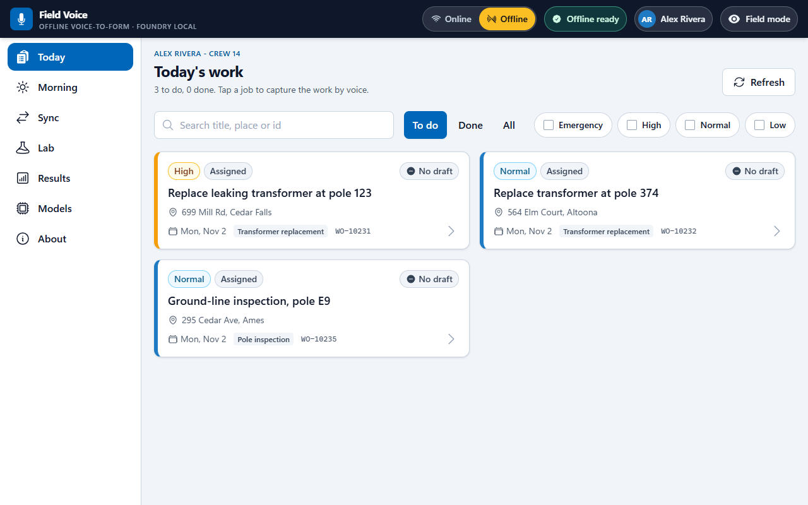
*The airplane-mode switch is on ("Offline"); the readiness chip stays green; the three jobs are served from the device.*

* **Under the hood.** The switch is the demo's airplane mode. Every call that would reach the remote system now answers
  "offline" immediately, while the speech and language models keep working because they run in the same process and never
  needed the network. The dispatcher console (the remote world) stays reachable so a presenter can play both sides.
* **Honest note.** This is an app-level switch. A test with the operating system's network adapter disabled has not been run
  yet (section 9).

#### Step 4. Open the job

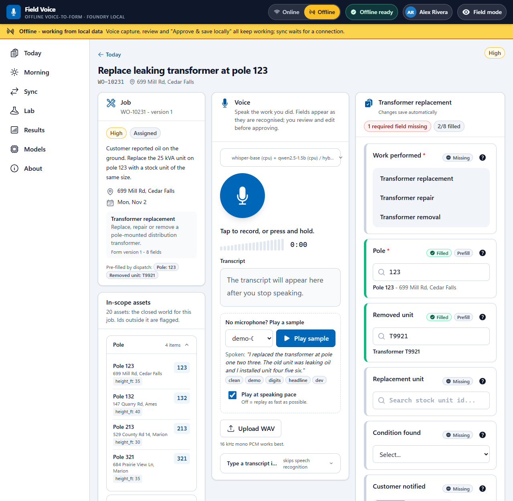
*WO-10231 before anyone speaks. Dispatch pre-filled the pole (123) and the removed unit (T9921). Required fields are marked; the
left column lists the job's "closed world".*

* **Under the hood.** The **closed world** is the set of assets this job may legitimately mention: its poles, the transformer
  being removed and the truck's stock units (20 assets here). Every id the extraction finds is resolved against it.
* **Why it matters.** "Pole 123" and "pole 132" sound alike. With a closed world a mishearing becomes a **flagged** field
  ("not in today's assets; closest: ...") instead of a silent error.

#### Step 5. Say the sentence

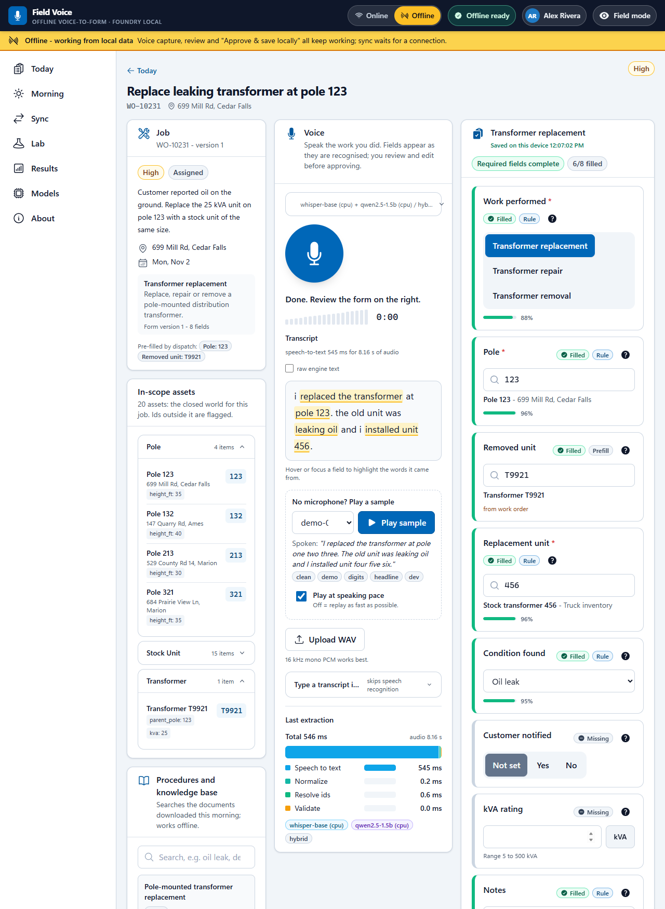

*The headline sentence played from the demo samples (a synthetic voice). The four fields it speaks to are filled, plus Notes
from the transcript, in about half a second of speech recognition; the removed unit comes from dispatch and shows "Prefill".*

* **What you see.** The transcript appears, then the fields fill progressively. Each carries a status (Filled), a source (Rule
  or Prefill) and a confidence. The waterfall at the bottom of the voice panel shows speech-to-text 545 ms for 8.16 s of audio,
  normalization 0.2 ms, id resolution 0.6 ms, validation 0.0 ms. **The language model was not called**: every word was
  explained by the rules.

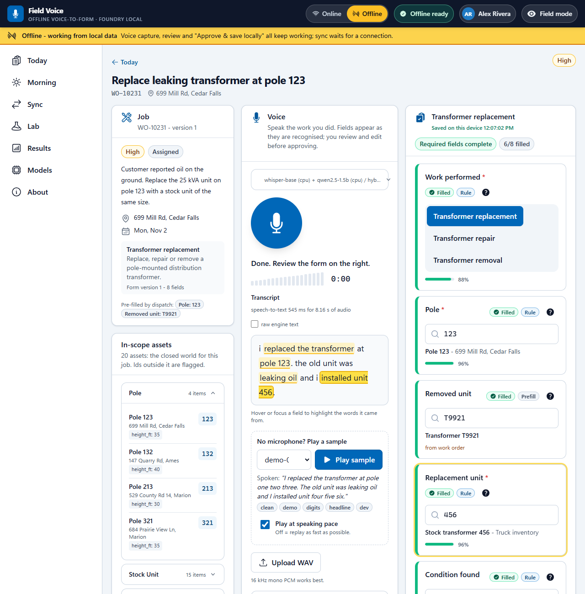
*Hover or focus a field and the words it came from light up in the transcript (here "installed unit 456" for the Replacement
unit).*

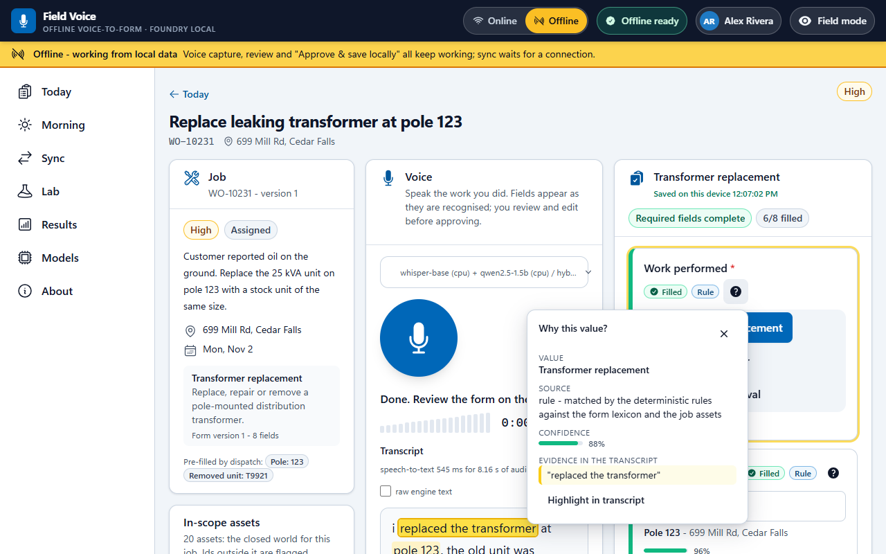
*"Why this value?": the value, its source (a deterministic rule), the confidence and the exact words of evidence.*

* **Under the hood.** The pipeline is described in section 6.2. In short: text normalization (spoken digits to numbers),
  deterministic resolution against the closed world, then validation.
* **Why it matters.** Trust and speed. A worker can see *why* each value was filled, and nothing generative sits on the
  critical path.

#### Step 6. Slang the rules have never heard

The scripted line **demo-04** is deliberately outside the form's vocabulary: *"So I did a change-out on the can over at pole
one two three, the old unit was weeping badly. Unit four five six went in."* The speech model heard "can" as "kin" (visible in
the transcript below); that does not matter here, because the rules do not know "change-out on the can" or "weeping" either.

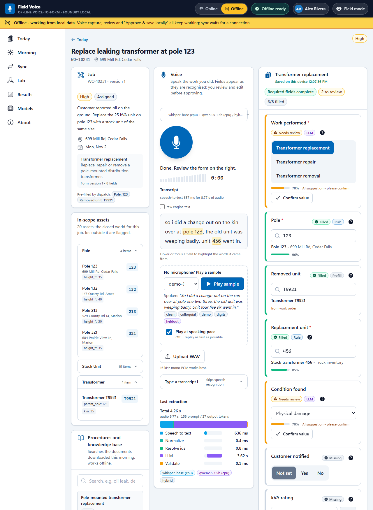

*With the default 1.5B model: the pole and the replacement unit come from the rules and the removed unit from dispatch;
**Work performed** and **Condition found** come from the language model and are marked "Needs review - AI suggestion, please
confirm". This time the model suggests "Physical damage" for "weeping", which is wrong, and it is amber, at 70 %, one tap away
from being fixed.*


*The same line after switching the language model to `qwen2.5-3b` (Engines panel): both suggestions are right ("Oil leak"),
at the price of a slower language-model stage (12.3 s on this busy laptop; about 5-7 s in the controlled benchmark) and more
memory.*

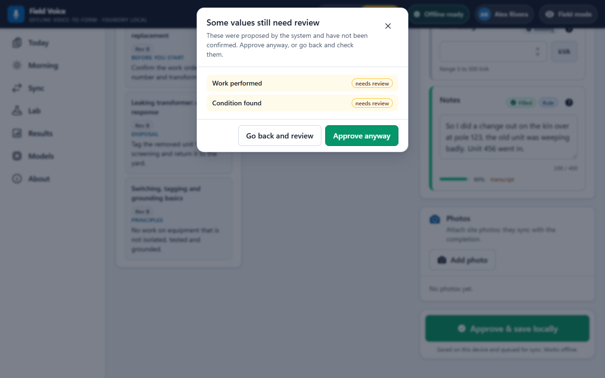
*Approving with suggestions still unconfirmed opens a dialog that names them. Nothing is approved by accident.*

* **Under the hood.** The model is asked only about the fields the rules could not settle, with a short, grammar-constrained
  prompt (158 prompt tokens and 27 output tokens here). Its answers are always **needs review**, never "filled".
* **Why it matters.** This is the central design choice: a small model is a *helper*, not an authority. A wrong suggestion is
  visible and cheap to correct; a bigger model fixes more of them but costs seconds and memory. Section 5 measures that trade.
* **One sentence is an anecdote.** Whether 1.5B or 3B is right for the fleet is decided on the 63-case held-out set in
  section 7, not on this line.

#### Step 7. Required fields

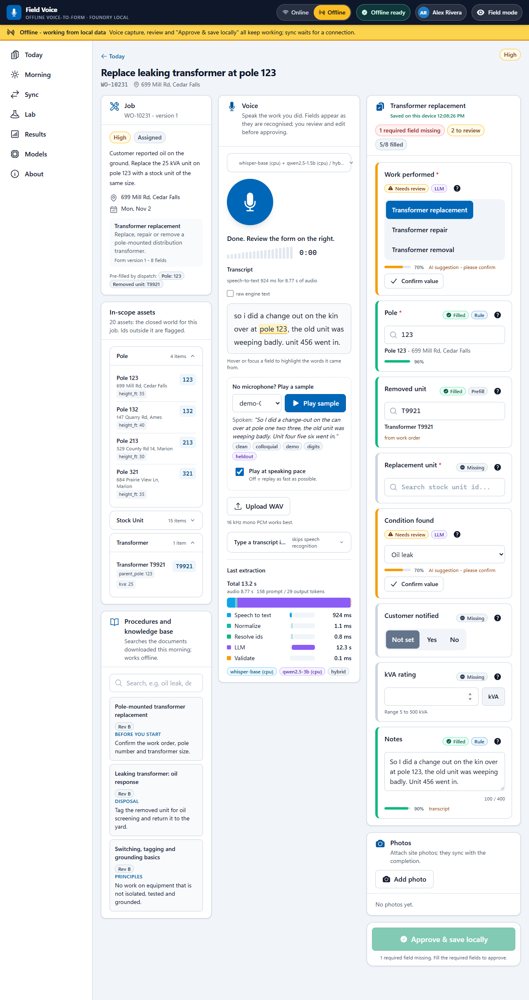
*A required value is missing (here the Replacement unit was cleared by hand): **Approve & save locally** is disabled and says
why.*

* **Under the hood.** Requirements can be conditional: the Replacement unit is required only when the work performed is a
  transformer replacement. Merging is deliberately conservative: later speech *adds* to the form, **a value the worker typed is
  never overwritten**, and an utterance that says nothing never blanks a field.

#### Step 8. Approve and save locally

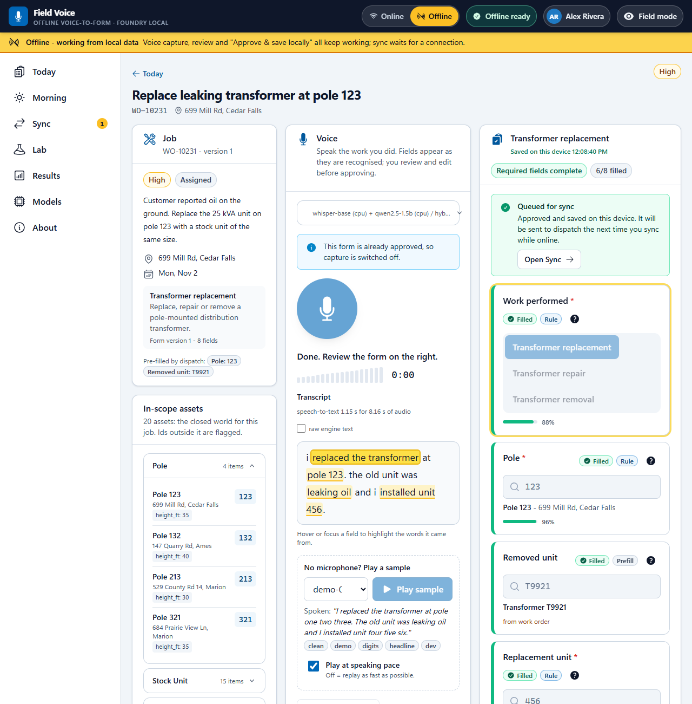

*After approval the form is locked, capture is switched off, and the page says "Queued for sync". The Sync entry in the menu
shows one waiting item.*

* **Under the hood.** One transaction in the local SQLite store marks the draft approved, assigns an **operation id** (the
  idempotency key) and writes the outbox rows (the completion and one row per photo). Approving twice returns the same
  operation, never a second one, and the outbox survives a restart.
* **Also in the day (not pictured).** Search the procedures offline (BM25 over the 6 downloaded documents, boosted for the
  open job) and attach site photos, which travel with the completion.

### Back online

#### Step 9. Sync, conflict, resolve

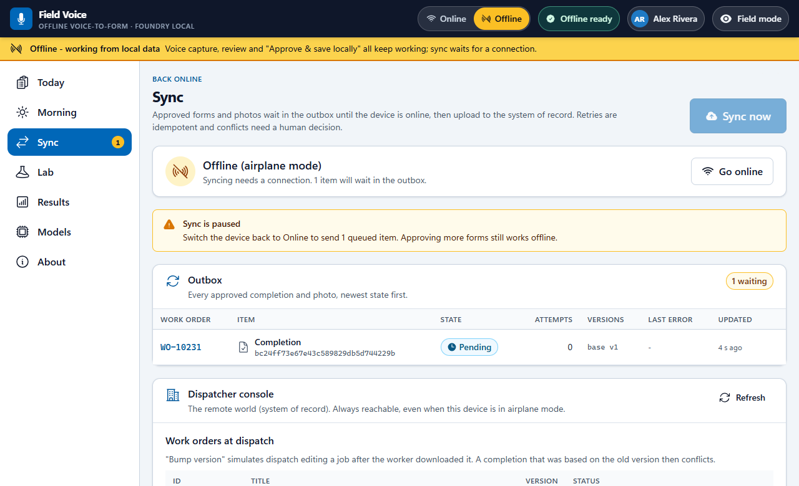
*Offline, the completion waits as **Pending** and sync is paused. Approving more forms still works.*

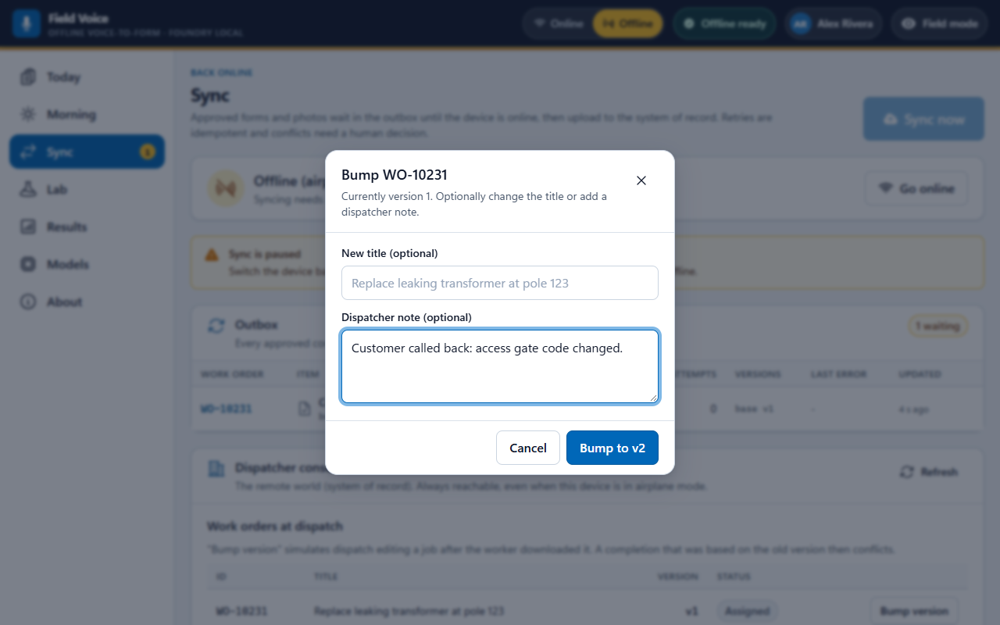
*The dispatcher console is the remote world. "Bump version" simulates dispatch editing the job after the worker downloaded it.*

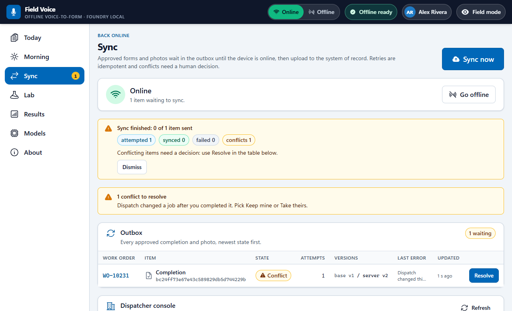
*After "Go online" and "Sync now": the completion was based on version 1 and dispatch is now at version 2, so it is a
**conflict**, not an overwrite.*

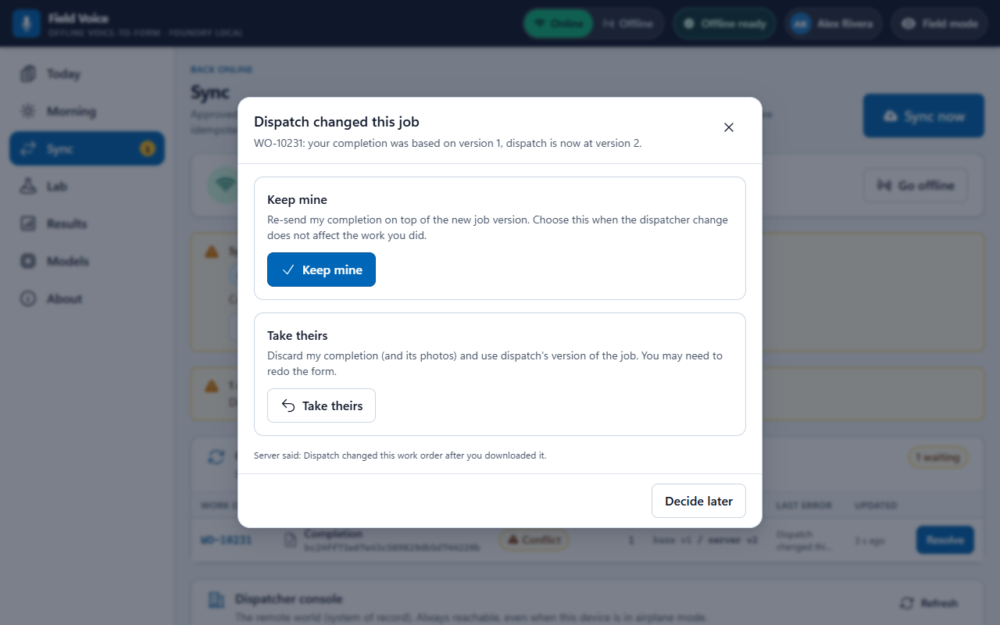
*The worker chooses. **Keep mine** rebases the completion onto the new version; **Take theirs** discards it and refreshes the job.*

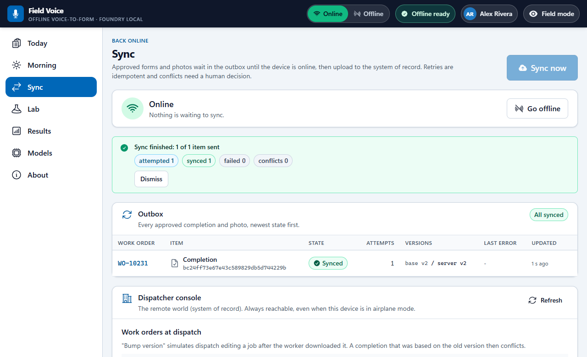
*"Keep mine" re-queued the completion as Pending at version 2; the next "Sync now" delivers it (**Synced**, base v2 / server v2).*

* **Under the hood.** Each completion carries the job version it was based on (`base_version`). If dispatch moved on, the server
  answers 409 with its version and the item becomes a conflict that a human resolves. Nothing is silently overwritten.

#### Step 10. A lost reply

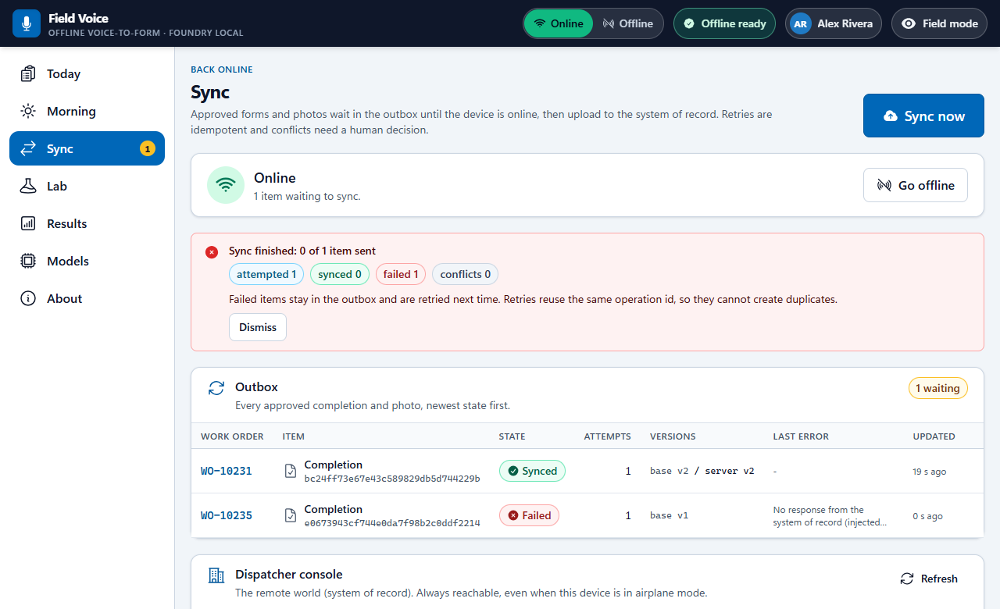
*A second job (WO-10235) was approved with the fault "Drop response next" armed: dispatch **commits** the completion but the
reply is lost. The device cannot know, so it shows **Failed** ("No response from the system of record ...").*

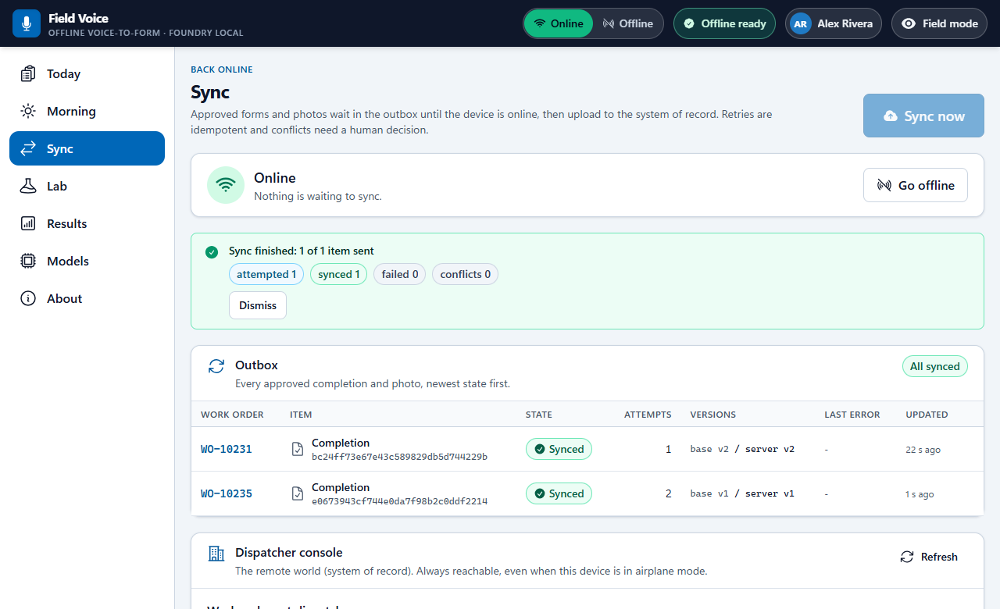
*"Sync now" again: the retry carries the same operation id, dispatch recognizes it and answers with the original result. The
item is Synced on attempt 2.*

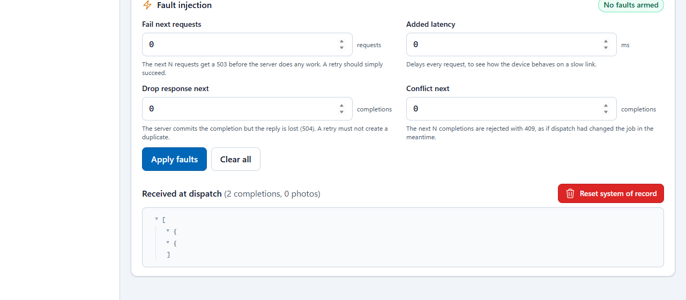
*At dispatch: "Received at dispatch (2 completions, 0 photos)" - exactly two, not three. The panel above it holds the other
faults you can inject (failed requests, added latency, forced conflicts).*

* **Why it matters.** Networks in the field fail in the worst way: after the server has done the work. Idempotent retries are
  what make "try again" safe.

#### Step 11. Back on the Today list

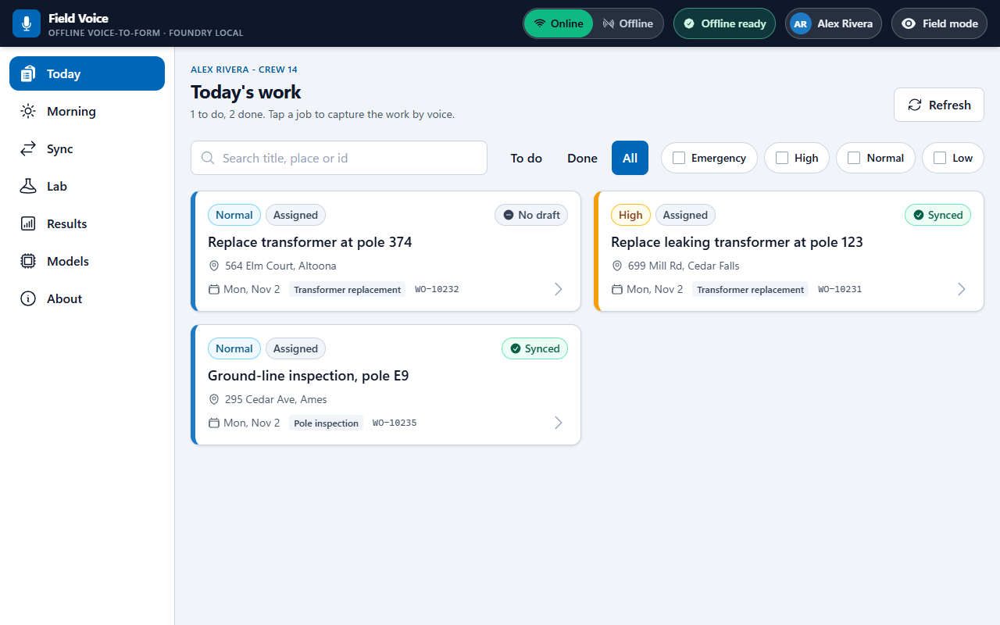
*Both completed jobs show **Synced**; the header counts "1 to do, 2 done". The untouched job (WO-10232) still has no draft.*

---

## 5. Choosing the engines on evidence

The second half of the demo answers the question the customer asked: which speech engine and which language model? Instead of
picking one and defending it, the app lets you run the *same* input through many combinations and compare them.

### 5.1 Models

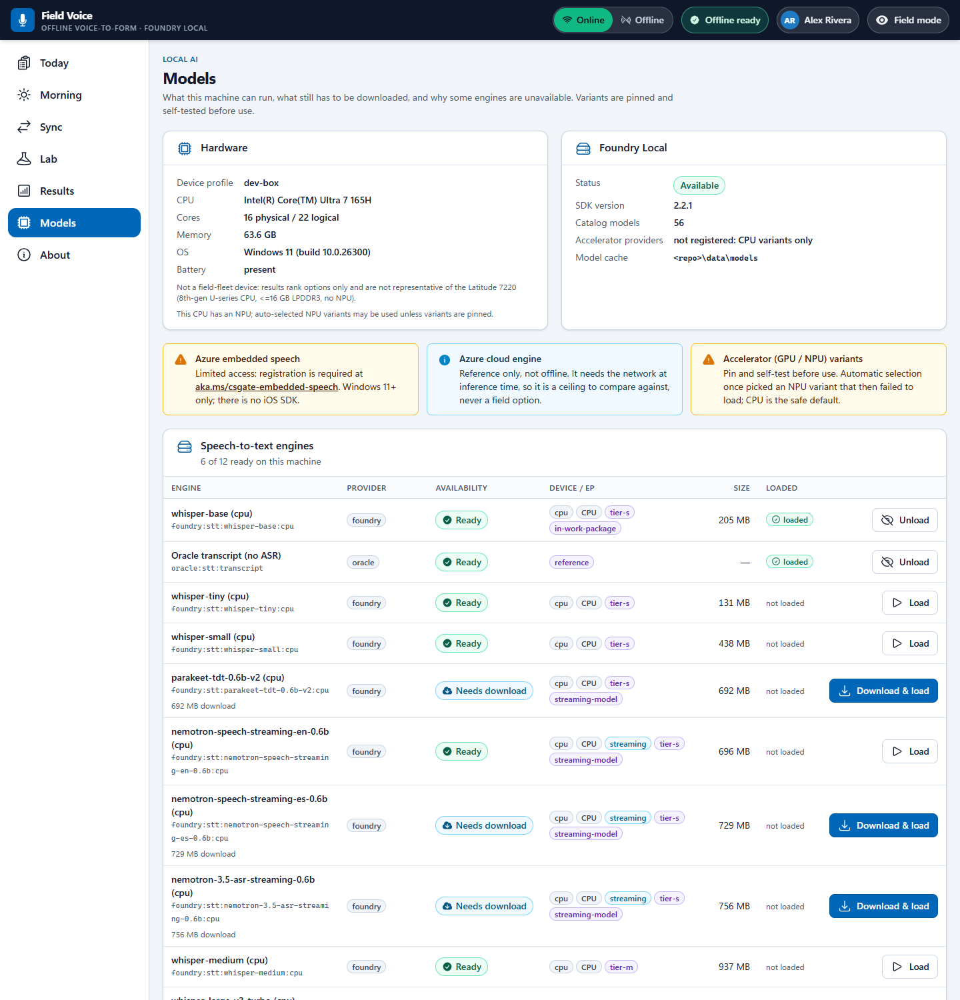

*What this machine can run. The list shows each engine's size, whether it is downloaded and whether it is loaded in memory.*

Foundry Local is available (SDK 2.2.1, 56 models in the catalog on this machine). Every engine variant is **pinned to CPU**:
once, when Windows machine-learning execution providers were registered, automatic selection picked an NPU variant that then
failed to load ([FINDINGS.md](FINDINGS.md)). The Azure engines (embedded and cloud) are implemented but have not been measured
because they need credentials or limited-access model files.

### 5.2 Lab: one utterance, many combinations

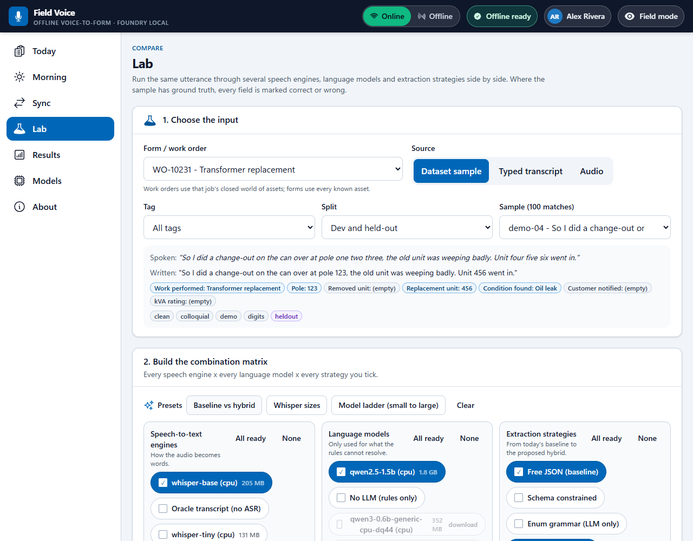

*Pick a form and an utterance (a dataset sample, a typed transcript, or audio), tick the speech engines, language models and
extraction strategies, then compare. Presets cover the common questions.*

Each result card shows the transcript, a latency waterfall and, for samples with ground truth, every field marked correct or
wrong. **Silent-wrong** counts confident values that are wrong.

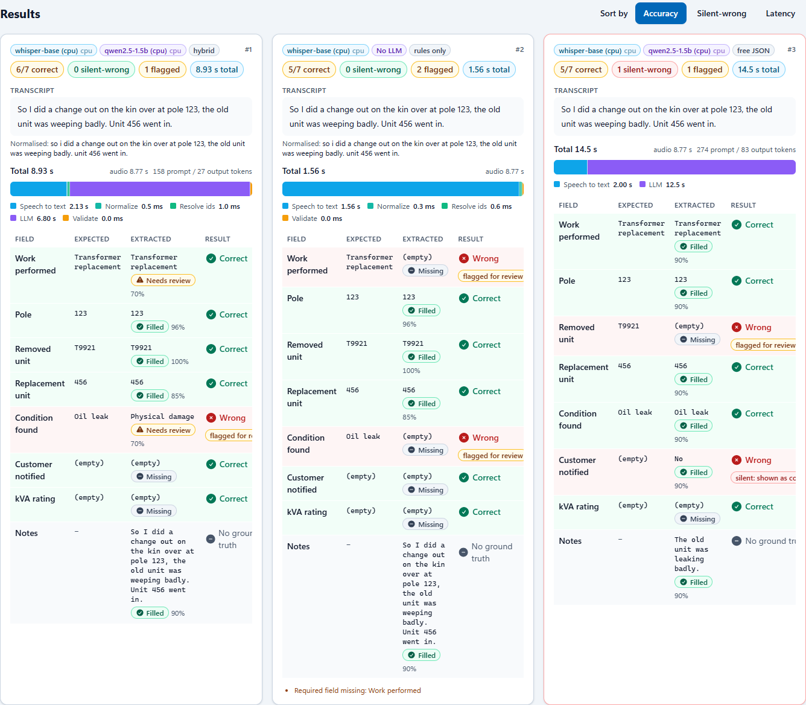

*The slang line three ways. **Hybrid** (rules, then the 1.5B model for what is left): 6 of 7 right, nothing silently wrong,
the one error flagged. **Rules only**: 5 of 7, the two fields it cannot read are left empty and flagged, and it is the
fastest. **Free JSON** (one prompt with the whole form and no rules: our reconstruction of the prototype-style approach): 5 of
7 and one value that is silently wrong ("Customer notified: No", which was never said), and the slowest.*

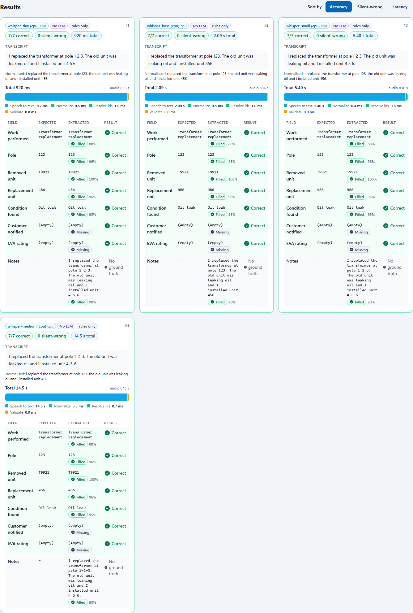

*Four Whisper sizes on the headline sentence. All four extract all seven fields correctly after normalization, even though they
write the numbers differently ("pole 1 2 3", "pole 123", "pole 1-2-3"). What differs is the time: 0.9 s, 2.1 s, 5.4 s and
14.5 s in this single run.*

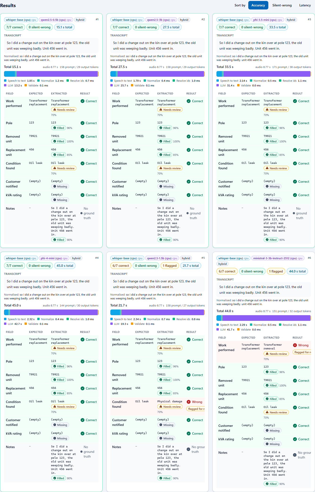

*Six language models on the slang line. Four get all seven fields right, two get six (the 1.5B model says "Physical damage";
Ministral says "Transformer removal"). Both errors are flagged for review.*

> **Read the Lab as a way to look, not a way to rank.** One sentence is an anecdote: the 0.5B model happens to get this line
> right, yet on the 63-case held-out set its suggestions are wrong more often than right (section 7). The Lab times are also
> *first-call* times (each combination loads its model first) on a laptop that was doing other work, so they are several times
> slower than the controlled benchmark.

### 5.3 Results: the evaluation matrix

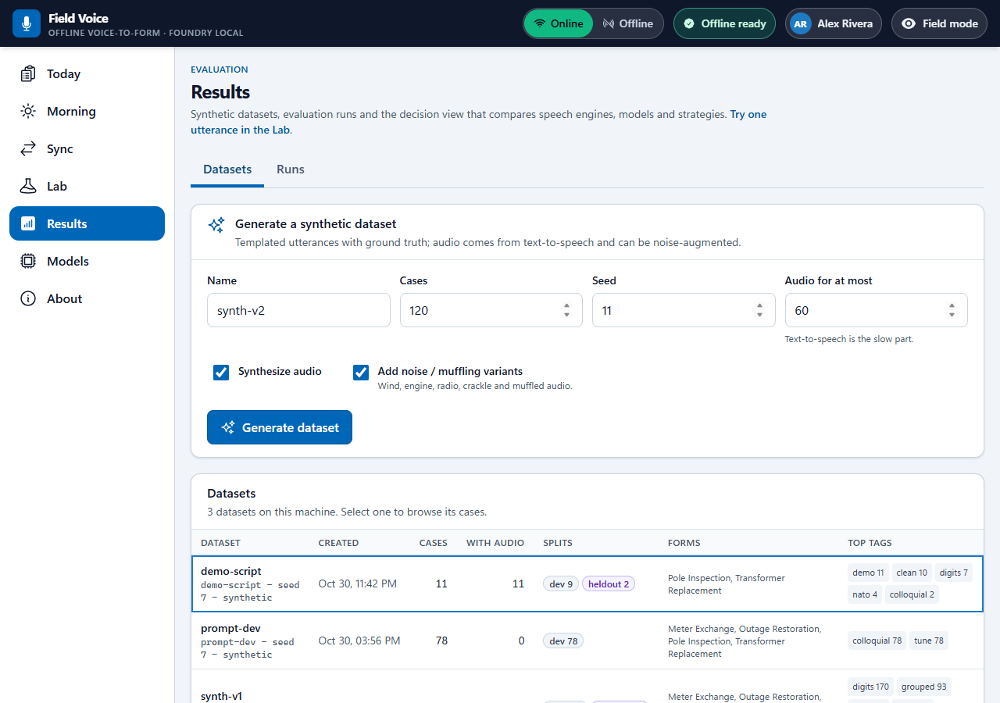

*Datasets: the synthetic sets the evaluation runs on (generator form at the top).*

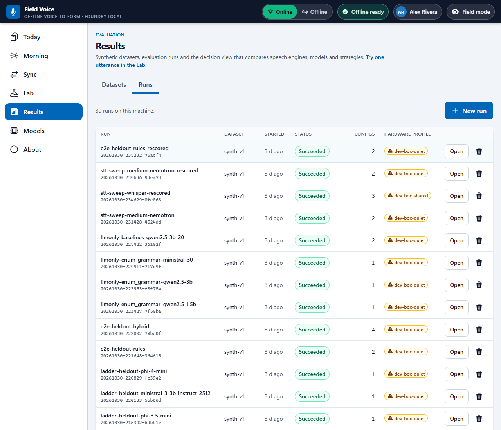

*Stored evaluation runs. The 30 that ship in `results/` can be loaded with `scripts\load_sample_results.bat`.*

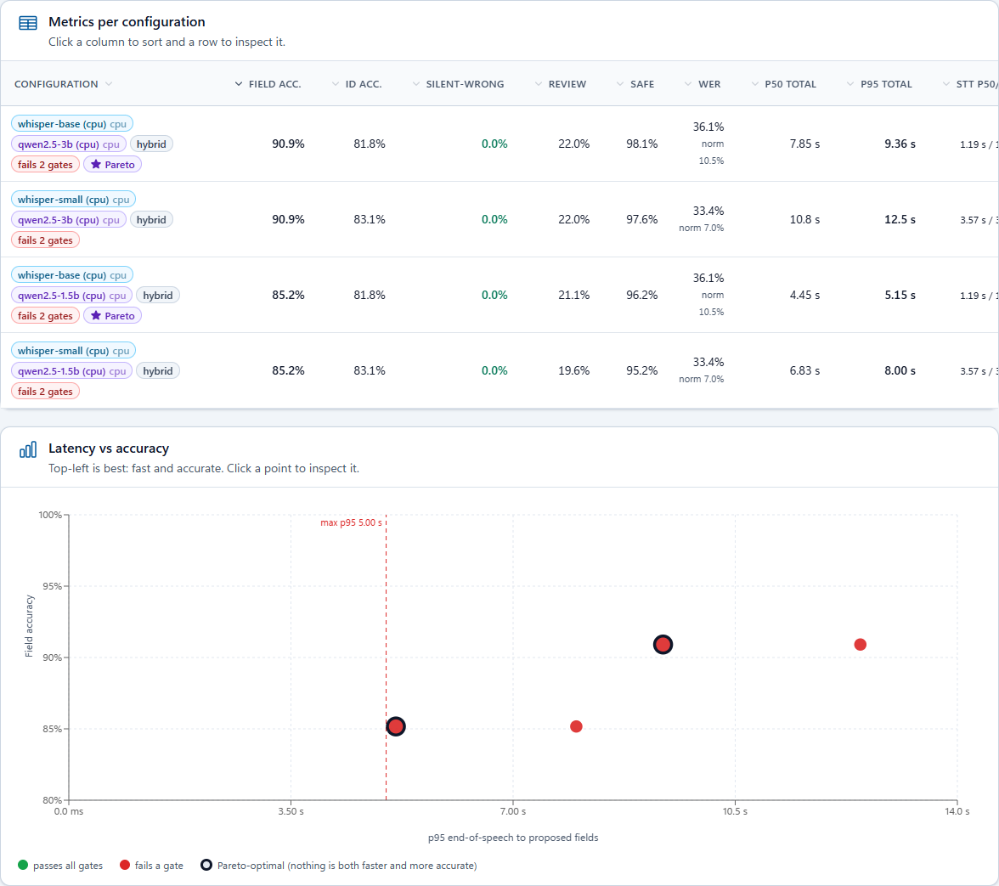

*One run, four speech and language combinations: accuracy, id-field accuracy, silent-wrong, review rate, word error rate
(raw and normalized), latency and memory, plus the latency-versus-accuracy chart. Circled points are Pareto-optimal: nothing
else is both faster and more accurate.*

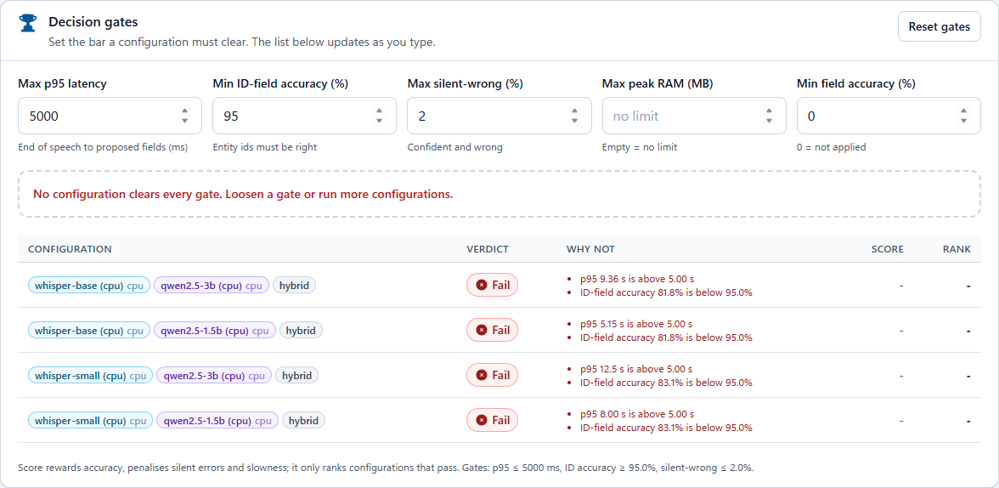

*The **decision gates**. Set the bar a configuration must clear and the list below updates as you type. With the starting
gates, **no configuration clears every gate** on this synthetic audio and laptop. That is a legitimate, honest outcome and
exactly why the screen is meant to be re-run with the customer's recordings on the real tablet.*

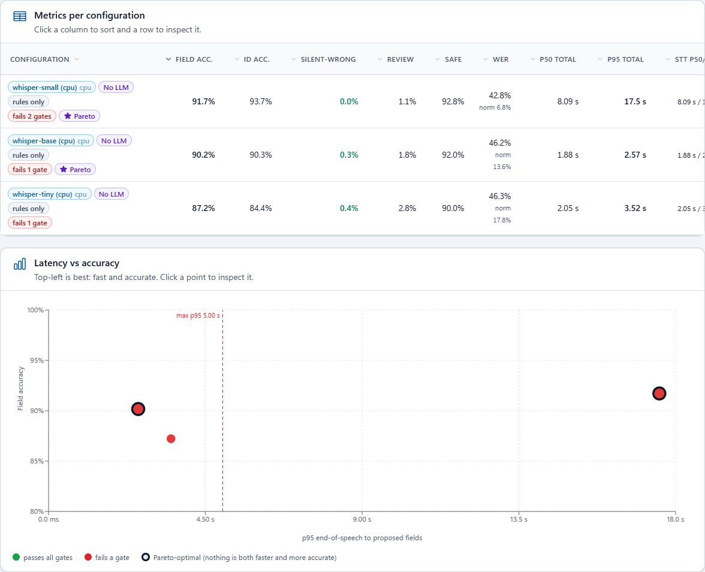

*A speech-engine sweep (Whisper tiny, base, small). This stored run was recorded while the laptop was busy, so its latency
columns are inflated; [RESULTS.md](RESULTS.md) uses a quiet-machine probe for the times. The WER column shows the raw word
error rate (punctuation and number style count as errors) and, below it, the normalized one.*

---

## 6. How it works (technical)

### 6.1 Components

The whole demo is **one local process**: a FastAPI server that also serves the built React UI, with Foundry Local running
in-process, a SQLite store and the mock system of record. The browser or WebView talks to `127.0.0.1`.

| Concern | Where | Notes |
|---|---|---|
| UI | `frontend/` | React 18, TypeScript, Vite, TanStack Query, Tailwind. Works against the real backend or a built-in mock API. |
| API | `backend/api/` | REST under `/api/v1` plus the `/ws/voice` WebSocket. Long operations are *jobs* that report progress. |
| Extraction | `backend/core/` | Pure Python: normalize, resolve, validate, six strategies. The language model never sees what the rules explained. |
| Engines | `backend/engines/` | Speech and language engines behind one interface: Foundry Local, optional Azure, oracle and rules-only. |
| Offline systems | `backend/demo/` | Local store, auth, bundle, knowledge base, sync, mock system of record and dispatcher console. |
| Evaluation | `backend/evalkit/` | Runner, metrics, decision report, CLI, device probe, golden vectors. |
| Synthetic data | `backend/synth/` | The world, utterance generator, text-to-speech, noise, dataset builders. |

The full diagram and the extension points are in [ARCHITECTURE.md](ARCHITECTURE.md); the offline pieces in
[SYSTEMS.md](SYSTEMS.md).

### 6.2 The extraction pipeline

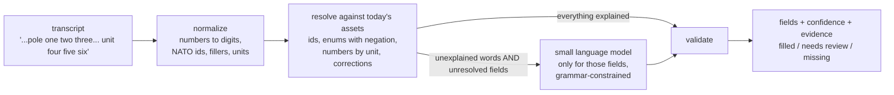

* **Normalize.** "pole one two three", "pole 1 2 3", "pole 1-2-3" (Whisper-medium's style) and "pole 123" all become the same
  text; phonetic spellings become ids ("tango nine nine two one" is `T9921`).
* **Resolve.** Ids are assigned to *roles* using the role words ("pole", "old unit", "installed") and what kind of asset the id
  is in today's world. Spoken corrections ("132, sorry, 123"), negation ("not leaking" is no issue) and units ("25 k v a")
  are handled. The resolver refuses to guess: an id that is not in the job's assets is flagged with the closest valid ids.
* **The language-model gate.** The model is called only when words remain that nothing explained **and** fields are still
  unresolved, and only about those fields. Three guards stop a small model from putting words in the worker's mouth: a
  boolean is only asked about when the statement touches its topic; "none / no issues" is accepted only when the statement
  says something negative or reassuring; and generic words from other options' wording do not count as "explained".
* **Validate.** Required fields, conditional requirements and numeric ranges.

The strategies form an ablation ladder you can select per request: `free_json` (the prototype-style baseline),
`schema_constrained`, `enum_grammar`, `hybrid` (the default), `hybrid_always` and `rules_only`
([EVALUATION.md](EVALUATION.md)).

### 6.3 What a field looks like

Every field the pipeline returns is a `FieldValue`. This is the Replacement unit from Step 5, exactly as the API returns it for
the headline sentence:

```json
{
  "key": "replacement_unit",
  "value": "456",
  "source": "rule",
  "confidence": 0.96,
  "status": "filled",
  "evidence": { "start": 75, "end": 93, "text": "installed unit 456" },
  "note": null,
  "candidates": []
}
```

* `status`: `filled`, `needs_review`, `missing` (left empty on purpose, never guessed) or `conflict`.
* `source`: `rule`, `embedding`, `llm`, `user` (typed by the worker) or `prefill` (from dispatch).
* `evidence` is a character span in the normalized transcript; the UI uses it for the highlight.
* `candidates` holds the alternatives offered to the reviewer (for example the closest valid ids).

### 6.4 Live capture protocol

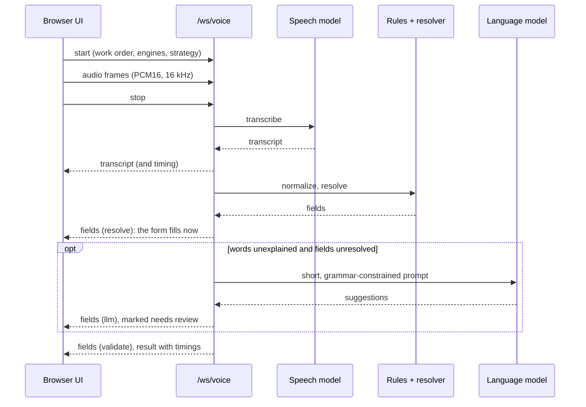

The browser can also play a dataset sample "as if from the microphone" (what the demo samples do), and a streaming engine
(Nemotron) sends interim `partial` text while the worker is still talking. Message shapes are in
[CONTRACT.md](CONTRACT.md) section 7.

### 6.5 Offline systems

| Piece | Behavior |
|---|---|
| **Local store** | SQLite (WAL) behind one connection: bundle, session and offline grants, drafts, photos, outbox. Approval is one transaction. |
| **Work package** | Per worker: the jobs, their forms, the job assets **plus the truck's stock inventory**, the attached documents and a model manifest. The device verifies the hash; the package expires 36 h after issue and readiness fails after that. |
| **Knowledge base** | BM25 over document sections with the same stemmer as the normalizer; pure Python, no network and no model. |
| **Auth** | Online login stores a PBKDF2 offline grant; offline unlock needs the right PIN and an unexpired grant. |
| **Sync** | The outbox is written in the approval transaction. Retries reuse the operation id. A job-version mismatch is a conflict. |

Outbox item states: **Pending** (waiting), **Synced**, **Failed** (transient error; retried on the next run with the attempt
counted) and **Conflict** (needs a decision: *Keep mine* re-sends the same operation on top of the new version, *Take theirs*
discards it).

### 6.6 Foundry Local

The speech and language models run **in-process** through the Foundry Local Python SDK (version 2.2.1, pinned), loaded from the
Foundry catalog into `data\models`. The same runtime has C#, JavaScript and Rust SDKs, which is the route to a native Windows
client ([ARCHITECTURE.md](ARCHITECTURE.md#deployment-shapes)). The registry keeps at most three models resident (least
recently used is unloaded; `FV_MAX_LOADED_MODELS`). Variants are pinned to CPU unless `FV_FOUNDRY_REGISTER_EPS=true`.
Constrained decoding (a grammar for enum and id answers) is what keeps the model's output short and well-formed.

What Foundry Local does **not** offer, found while building this ([FINDINGS.md](FINDINGS.md)): Whisper "initial prompt" biasing
toward the day's ids (the field is ignored), and prefix/KV-cache reuse on the grammar path. Azure Speech's phrase lists are the
speech-side lever that fills the first gap.

### 6.7 The evaluation harness

* **Datasets** (all synthetic): `synth-v1` (240 generated cases, speech for 120 of them, half with simulated wind, engine,
  radio, crackle or muffled noise, plus a held-out split written in colloquial phrasing), `demo-script` (the 11 scripted
  lines) and `prompt-dev` (78 hand-written colloquial lines used only to tune the prompt).
* **Metrics.** Field accuracy, **id-field accuracy**, enum accuracy, **silent-wrong**, hallucination rate, review rate, word
  error rate (raw and normalized), p50/p95 latency by stage, real-time factor, cold start and resident memory.
* **Reproducibility.** Every run is stored with its configuration and hardware profile; a normalizer fix can be re-scored on
  the stored transcripts in seconds (`run_eval.bat rescore`); regression-tested "golden vectors" keep the normalizer and
  resolver identical across platforms (they feed the iOS port).
* **The data found real bugs.** Running the pipeline over generated utterances found and fixed ten genuine defects
  ([DATASET.md](DATASET.md#what-the-data-found)), and re-reading a failed speech sweep found a hyphenated-digit normalization
  gap (Whisper-medium writes "1-2-3"; fixing it moved its id accuracy from 89.2 % to 94.1 %).

---

## 7. What we measured

All of this is synthetic data on **one developer laptop** (Core Ultra 7 165H, 16 cores, 64 GB). The numbers *rank options
against each other on identical input*. They are not predictions of field accuracy or tablet latency. The full tables, the
method and the commands to reproduce them are in [RESULTS.md](RESULTS.md); the raw runs are in [`results/`](../results/README.md).

### Speech-to-text (120 clips, rules-only extraction)

| Engine | Id-field accuracy | Field accuracy | Wait after the speaker stops | Memory |
|---|---|---|---|---|
| whisper-tiny | 84.4 % | 87.2 % | 0.77 s | 113 MB |
| **whisper-base** (default) | 90.3 % | 90.2 % | 1.15 s | 159 MB |
| whisper-small | 93.7 % | 91.7 % | 3.65 s | 379 MB |
| whisper-medium | 94.1 % | 92.0 % | 9.5 s (slower than real time) | 930 MB |
| Nemotron streaming 0.6B | 89.2 % | 89.9 % | **0.19 s** live | 483 MB |

* Whisper-base is the sensible default; small buys +3 points of id accuracy for 3x the time; medium buys nothing more.
* Streaming shows the final text 0.19 s after the speaker stops, but it drops spoken corrections ("sorry, 328") and only hides
  latency while it keeps up with real time (0.45x here; **unmeasured on a tablet**).
* No engine clears a 95 % id gate on noisy synthetic audio; the closed world turns most misses into flagged fields (0-0.7 %
  silent-wrong). **Azure Speech is unmeasured** (no credentials); its phrase lists are the likeliest route past the gate.

### Extraction (63 held-out cases, correct transcript, hybrid strategy)

| Language model | Field accuracy | Enum accuracy | Hallucination | Call time (p50) | Memory |
|---|---|---|---|---|---|
| none (rules only) | 81.7 % | 37.7 % | 0 % | none | none |
| qwen2.5-0.5b | 85.0 % | 49.1 % | 7.7 % | 1.2 s | 0.8 GB |
| **qwen2.5-1.5b** (default) | 93.4 % | 77.4 % | 2.2 % | 3.2 s | 1.7 GB |
| qwen2.5-3b | **98.3 %** | **94.3 %** | 1.1 % | 6.2 s | 3.0 GB |
| phi-3.5-mini | 97.0 % | 89.6 % | 0 % | 8.5 s | 3.6 GB |
| ministral-3-3b | **98.3 %** | **94.3 %** | 0 % | 7.4 s | 4.4 GB |
| phi-4-mini | **98.3 %** | **94.3 %** | 0 % | 7.2 s | 4.7 GB |

* **Id accuracy is 100 % in every row**: the rules and the closed world, not the model, resolve the ids.
* **Silent-wrong is 0 % for every model**, because model answers are always "needs review". About a fifth of fields arrive as
  suggestions to confirm.
* **Size is the lever** (enum accuracy 49 / 77 / 94 % for 0.5B / 1.5B / 3B). The 0.5B model is wrong more often than right: do
  not ship it. Qwen2.5-3B, Ministral-3-3B and Phi-4-mini tie; Qwen is the cheapest, the other two add zero hallucination for
  about 1.5x the memory.
* **The question's wording mattered as much as the model.** Separating "was it mentioned?" from the value moved the 1.5B model
  from 45 % to 77 % enum accuracy.

### What each layer buys (strategy ablation)

| Approach (held-out, correct transcript; free JSON and schema on the first 20 cases) | Silent-wrong |
|---|---|
| Rules only | **0 %** |
| Hybrid (rules, then a model for the rest) | **0 %** |
| Prototype-style free JSON, 3B model | 18.5 % |
| Constrained to a schema, 3B model | 34.6 % |
| Model answers every field itself, tight grammar (Qwen 1.5B / 3B) | 49 % / 50 % |

Constraining the output guarantees its *shape*, not its *truth*. Without the deterministic layer, ids are the casualty and
roughly half of the confident fields are silently wrong.

### Where the time goes

A model call costs its **prompt**: about 18 ms per prompt token for a 1.5B model on this machine, roughly 90 % of a call. That
is why the design calls the model only for what the rules could not explain, with a short prompt, and shows the rules' result
first. The prototype-style call (a 240-token prompt, about 65 output tokens, 3B model) took 12.4 s here against about 6 s for the
hybrid's call, which also happens on fewer cases and after the rules result is already on screen.

### End to end (36 held-out clips, speech then extraction)

| Speech + model | Id-field accuracy | Field accuracy | Total p50 / p95 | Memory |
|---|---|---|---|---|
| whisper-base + qwen2.5-1.5b | 81.8 % | 85.2 % | 4.4 / 5.2 s | 2.0 GB |
| whisper-base + qwen2.5-3b | 81.8 % | 90.9 % | 7.9 / 9.4 s | 3.3 GB |
| whisper-small + qwen2.5-3b | 83.1 % | 90.9 % | 10.8 / 12.5 s | 3.7 GB |

The two stages are independent: speech sets the id accuracy, the model sets the enum accuracy. This is the subset with the
hardest, most colloquial phrasing, which is why it scores below the tables above.

---

## 8. What it means for the fleet, and what to do next

### Estimates for a rugged tablet (not measurements)

For a 4-core 8th-generation U-series CPU with no NPU and slower memory, expect:

* language-model prompt processing **4-6x** slower, so a 1.5B call of 2.4-3.2 s here is roughly **10-20 s** there, and a 3B
  call 20-35 s;
* generation 2-3x slower (a 2-3 GB model cannot exceed roughly 10-13 tokens/s on that memory);
* Whisper-base at roughly 0.6-1.5x real time (an 8 s sentence in 5-12 s), tiny as the fallback;
* streaming speech only hides the wait while it keeps up; at 4-6x slower, Nemotron would fall behind;
* memory is fine for 8 GB with the default pair (about 2 GB resident).

**Design consequences already in the product:** the rules' result appears immediately after speech; model suggestions arrive
as a second, progressive update while the worker is already reviewing; the language model is optional (`rules_only` is the
fallback when it is missing or too slow). These estimates are why the first next step is to measure on the device.

### Platforms

* **Windows tablets:** the demo is a local web app. The recommended production direction is a native Windows client using the
  Foundry Local C# SDK and the same contracts, with the Python core as the reference implementation.
* **iOS:** Foundry Local does not target iOS. The contracts and the deterministic core port (golden vectors keep the ports
  identical); the on-device model runner needs a spike. `ios-spike/` holds a benchmark kit that has **not been compiled**
  ([IOS_SPIKE.md](IOS_SPIKE.md)).

### Proposed next steps

1. **Measure on the real tablet** (about an hour): `scripts\bench_device.bat` for each speech and language engine, then the
   same evaluation matrix with the device profile set. This replaces the estimates above. While there, confirm which model
   the current prototype really uses (it was described to us as "GPT-3.5 mini", which is not in the Foundry Local catalog;
   Phi-3.5-mini is the closest match we know of), so the comparison baseline is the real one.
2. **Record 100-150 labelled utterances** with the actual microphone or headset, in representative noise, using the customer's
   real vocabulary. That is enough to confirm or overturn the ranking ([EVALUATION.md](EVALUATION.md#6-replacing-synthetic-data-with-customer-data)).
3. **Put the customer's forms and phrasing into the lexicon.** The vocabulary is the cheapest accuracy lever: every phrase a
   subject-matter expert adds is a field the model no longer has to guess.
4. **Add Azure Speech with phrase lists** to the comparison and see whether it clears the 95 % id gate.
5. **Agree the gates** (latency, id accuracy, silent-wrong, memory) and let the Results page recommend a configuration.
6. **Then build:** a native Windows client, the iOS runner spike, a real system-of-record integration, device management and
   an encrypted store, and a field pilot that measures the share of fields workers correct and the time saved.

---

## 9. What is proven and what is not

| | Status |
|---|---|
| The whole day end to end in a browser against the real backend and real Foundry Local models (sign-in, morning prep, offline voice from sample playback, approve, sync with a conflict, a lost reply and an idempotent retry) | **Verified** on the dev laptop |
| Offline and sync logic (idempotent retries, injected faults, conflicts), the extraction pipeline and the API | **Covered by automated tests** (no network, no models) |
| Evaluation of Whisper (tiny to medium), Nemotron, Qwen, Phi and Ministral on synthetic data | **Measured** on the dev laptop |
| Behavior with the operating system's network actually disabled | Not tested (the app's airplane mode is a simulation of it) |
| Copying the model cache to a second machine for an air-gapped staging area | Expected to work; **not tested** |
| Speed and memory on the rugged tablet | **Not measured**; estimates only |
| Real field speech (accents, radio chatter, wind, PPE) | **Not tested**; the audio is clean synthetic speech plus simulated noise |
| Live microphone capture through the real backend | **Not tested** (sample playback and the WebSocket path are) |
| Azure Speech engines (embedded and cloud) | Implemented, **not measured** (no credentials) |
| iOS | Not built; the Swift kit is **uncompiled** scaffolding plus tested Python tooling |
| Encrypted storage, single sign-on, device management, a real system-of-record integration | **Not built** ([SYSTEMS.md](SYSTEMS.md#not-built-and-what-it-would-take)) |
| Windows 10 and Python 3.12+ | Not tested (developed on Windows 11 with Python 3.11) |

---

## Appendix A. The scripted demo lines

The 11 lines in the `demo-script` dataset. Each is spoken by a synthetic voice and has ground truth, so the Lab and the
evaluation can score it. Pick them from **Play sample** on the job page.

| Id | Job | What the worker says | What it shows |
|---|---|---|---|
| **demo-01** | WO-10231 | "I replaced the transformer at pole 123. The old unit was leaking oil and I installed unit 456." | The sentence from the call. The removed unit comes from dispatch, not from speech. |
| demo-02 | WO-10231 | "At pole 123 I changed out the transformer. The old unit T9921 was corroded. New unit is 456, customer was notified." | Every field spoken; digits in groups; a letter id read in the phonetic alphabet. |
| demo-03 | WO-10231 | "I swapped the transformer at pole 132, sorry, 123. Installed unit 456." | A spoken self-correction: the last id wins, and 132 is a real neighboring pole. |
| **demo-04** | WO-10231 | "So I did a change-out on the can over at pole 123, the old unit was weeping badly. Unit 456 went in." | Slang the lexicon does not contain: the model suggests two fields for review. |
| demo-05 | WO-10231 | "Work order 10231. I replaced the transformer at pole 123 and installed unit 456. The unit was not leaking, customer notified." | A work-order number that is not an asset, and a negation. |
| demo-06 | WO-10231 | "I replaced the transformer at pole 123. The old unit was leaking oil." | The replacement unit is never said: on an empty form a required field stays open. |
| demo-07 | WO-10231 | "I replaced the transformer at pole 123 and installed unit 456, 25 kVA unit." | A quantity with a unit. |
| demo-08 | WO-10232 | "At pole 374 I repaired the transformer. The old unit T1003 was damaged." | The second transformer job of the day. |
| demo-09 | WO-10235 | "Inspected pole E9, 45 feet. The pole has woodpecker holes and it needs to be monitored." | A different form (pole inspection) from the same package. |
| demo-10 | WO-10235 | "Looked at pole E9 and it has been pecked up. Overall it bears watching." | Slang again, on the inspection form. |
| demo-11 | WO-10231 | The headline sentence, with a truck engine idling behind it | The same words, different audio (noise at 10 dB signal-to-noise). |

Also try saying a wrong id on purpose ("pole one two four") or pasting it into *Type a transcript*: it is not in today's
assets, so it is flagged with the closest valid ids.

---

## Appendix B. FAQ

**Does the technician need a connection during the day?** No. The network is used for sign-in, the morning download (including
any model download) and sync. Speech recognition and extraction run on the device.

**Does audio or text leave the device?** Not from this app. The models run in-process through Foundry Local and the app makes
no cloud call at inference time. Recordings are not kept: audio is held in memory and written to a temporary file only while
the speech model reads it, then deleted. We have not audited Foundry Local's own network behavior (catalog and model
downloads). The optional Azure cloud engine is the one engine that would send audio to a service; it is off by default and is
there only as an accuracy ceiling to compare against.

**What stops a wrong value reaching the system of record?** Ids are checked against the job's closed world; model answers are
never "filled", only "needs review"; Approve is blocked while a required field is empty and warns about unconfirmed
suggestions; and conflicts need a human. The residual risk is a misheard id that is a *valid neighboring asset*: the form
shows the asset's name and address under the id so the worker can notice it, and this is why the evaluation tracks
silent-wrong rather than plain accuracy.

**What if the language model is missing or too slow?** The pipeline falls back to `rules_only`: it still fills everything the
rules can read and leaves the rest empty for the worker.

**Can we use our own forms and vocabulary?** Yes. A form is a schema document (fields, synonyms, trigger words); the pipeline
itself does not change, and a lint step flags ambiguous synonyms. The vocabulary is the cheapest accuracy lever there is.

**Why not simply use a bigger model?** A model call costs its prompt, and the tablet is several times slower than the laptop
used here. The design gets accuracy from the deterministic layer and the closed world, and uses the model only for the slang
that is left.

**Why is the readiness chip sometimes amber?** The self-test checks that the language-model stage answers within 5 s. On a
busy or slow machine it can take longer. The device is still usable and the warning says why.

**Where is the data kept?** Under `data\` (git-ignored): the SQLite store, models, datasets and runs. In the demo the store is
**not encrypted**; the production list in [SYSTEMS.md](SYSTEMS.md#not-built-and-what-it-would-take) covers that.

**How do I reset to a clean take?** Sync, then Dispatcher console, then *Reset system of record* with *Also wipe this device*
ticked. It signs the worker out and removes the downloaded work, drafts and outbox; the models stay.

---

## Appendix C. Glossary

| Term | Meaning |
|---|---|
| **Foundry Local** | Microsoft's on-device runtime for running AI models locally, used here in-process through its SDK |
| **Closed world** | The assets a job may legitimately mention; ids are resolved against it |
| **Rules / deterministic** | Pure code (no model) that normalizes text and resolves ids, enums, numbers and corrections |
| **Hybrid** | The default strategy: rules first, a small model only for what is left |
| **Needs review** | A value the system proposes but the worker must confirm |
| **Silent-wrong** | A field shown as confident (not flagged) that is wrong; the error that matters most |
| **Hallucination** | A model answer for a field the statement never mentioned |
| **STT** | Speech-to-text |
| **WER** | Word error rate; "normalized" ignores punctuation and number style |
| **RTF** | Real-time factor: processing time divided by audio length (below 1 keeps up with speech) |
| **p50 / p95** | The median and the 95th-percentile (near worst case) of a measurement |
| **Prefill / generation** | A language model reads the prompt (prefill, the dominant cost here), then writes the answer (generation) |
| **Pareto-optimal** | A configuration nothing else beats on both speed and accuracy |
| **Work package / bundle** | Everything downloaded in the morning: jobs, forms, assets, procedures, model manifest |
| **Outbox** | Approved completions and photos waiting to be sent |
| **Operation id** | The idempotency key that makes a retried send safe |
| **Conflict** | Dispatch changed a job after the worker downloaded it; the worker chooses *Keep mine* or *Take theirs* |
| **System of record** | The company's work-management system the completions end up in (a mock here) |
